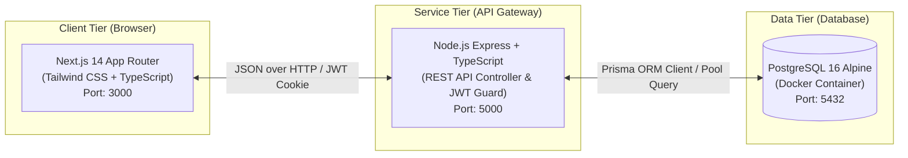

<div align="center">

# 📄 SIPESAT WEB
### Sistem Informasi Pengajuan Surat Siswa Berbasis Web
**Mata Kuliah: Rekayasa Perangkat Lunak (RPL) — Pertemuan 04 s.d. 15 (Tahun 2026)**  
**Program Studi Teknik Informatika — Fakultas Teknik dan Ilmu Komputer**  
**Universitas Indraprasta PGRI (UNINDRA) Jakarta**

[](https://unindra.ac.id)
[](#-anggota-kelompok-7)
[](https://nextjs.org/)
[](https://nodejs.org/)
[](https://www.postgresql.org/)
[](https://www.prisma.io/)
[](https://www.docker.com/)

<p align="center">
  <i>Platform digital mandiri untuk otomatisasi pelayanan persuratan dinas siswa di lingkungan sekolah dengan arsitektur Decoupled (REST API Express + Next.js App Router), penomoran surat otomatis, tanda tangan digital QR Code, dan perampingan 2 Role eksklusif (Siswa & Petugas TU).</i>
</p>

---

</div>

## 👥 Anggota Kelompok 7 (Pengembang Sistem)

| No. | Nama Lengkap | NPM | Peran & Tanggung Jawab |
| :---: | :--- | :---: | :--- |
| 1 | **Adam Wahyu Kurniawan** | `202343500510` | **Lead Developer & System Architect** (Arsitektur Backend/Frontend, Desain Database PostgreSQL, Integrasi Draw.io 7 Tab, & Standar SRS Karl Wiegers) |
| 2 | **Fathu Rahman** | `202343500467` | **Business Analyst & Documentation** (Analisis Kebutuhan Sistem, Pemodelan Alur Kerja, & Verifikasi Dokumen SRS) |
| 3 | **Surya Edi Saputra** | `202343500468` | **Quality Assurance & Testing** (Black Box Testing, Validasi Form Input Siswa & Verifikasi Hak Akses Role) |
| 4 | **Rizqi Muh. Al Hakimi** | `202343500449` | **UI/UX & Technical Writer** (Tata Letak Antarmuka Web, Layout Dokumen Laporan, & Presentasi Tugas) |

---

## 📚 Pusat Unduhan Dokumen Tugas Kuliah (Academic Deliverables)

Seluruh dokumen perancangan dan laporan tugas RPL Kelompok 7 telah disusun secara terstruktur sesuai standar modul resmi UNINDRA:

| Dokumen Tugas | Format Berkas Tersedia | Deskripsi & Ruang Lingkup |
| :--- | :---: | :--- |
| **Tugas 1: Pengajuan Judul & Gambaran Umum** | [`tugas-1-rpl.md`](tugas-1-rpl.md) • [`tugas-1-rpl.html`](tugas-1-rpl.html) • [`TUGAS_1_RPL_KELOMPOK_7.pdf`](TUGAS_1_RPL_KELOMPOK_7.pdf) | Gagasan awal, latar belakang masalah persuratan manual di sekolah, ruang lingkup aplikasi SIPESAT, dan pembagian tugas awal kelompok. |
| **Tugas 2: Dokumen SRS Standar IEEE Std 830-1998 (Karl Wiegers)** | [`tugas-2-srs-wiegers.md`](tugas-2-srs-wiegers.md) • [`tugas-2-srs-wiegers.html`](tugas-2-srs-wiegers.html) | Spesifikasi Kebutuhan Perangkat Lunak 5 Bab Lengkap: 1. Pendahuluan, 2. Deskripsi Keseluruhan, 3. Kebutuhan Antarmuka Eksternal, 4. Fitur Sistem, 5. Kebutuhan Non-Fungsional. **Revisi: Dirampingkan murni 2 Role (Siswa & Petugas TU)**. Siap dikumpulkan pertemuan 14/15. |
| **Tugas 4: Pemodelan Activity & Sequence Diagram Standar UML 2.5** | [`tugas-4-activity-sequence.md`](tugas-4-activity-sequence.md) • [`tugas-4-activity-sequence.html`](tugas-4-activity-sequence.html) | 4 Activity Diagram multi-swimlane (Pengajuan, Verifikasi, Approval, Tracking) & 4 Sequence Diagram Pola BCE (Boundary-Control-Entity) dilengkapi percabangan `alt`. |
| **Tugas 5: Pemodelan State Machine Diagram (UML 2.5)** | [`tugas-5-state-machine.md`](tugas-5-state-machine.md) • [`tugas-5-state-machine.html`](tugas-5-state-machine.html) • [`tugas-5-state-machine.docx`](tugas-5-state-machine.docx) • [`tugas-5-state-machine.pdf`](tugas-5-state-machine.pdf) | State Machine Diagram siklus hidup permohonan surat (`SuratPengajuan`), State Machine sesi autentikasi pengguna (`UserSession` JWT), State Transition Table, dan pemetaan ke enum PostgreSQL. |
| **Master Diagram Pertemuan 04 (Draw.io 7 Tab XML)** | [`use-case-siswa-admin.drawio`](use-case-siswa-admin.drawio) • [`use-case-siswa-admin.md`](use-case-siswa-admin.md) • [`use-case-siswa-admin.html`](use-case-siswa-admin.html) | Berkas grafik master UML 7 Tab XML lengkap sesuai modul Slide 5–7 dan 18–20 UNINDRA. Siap dibuka di diagrams.net dan dicetak format A4. |

---

## 🎨 Panduan Membuka & Mengedit Berkas Draw.io (`.drawio`)

File diagram master **[`use-case-siswa-admin.drawio`](use-case-siswa-admin.drawio)** dirancang menggunakan format native XML Draw.io / diagrams.net yang memuat **7 Tab Halaman Interaktif**:

1. **Buka Browser**: Akses layanan gratis [app.diagrams.net](https://app.diagrams.net/).
2. **Buka Berkas**: Pilih menu **`Open Existing Diagram`** (atau `File` ➔ `Open From` ➔ `Device`), lalu pilih file `use-case-siswa-admin.drawio` dari repositori ini.
3. **Pilih Tab Navigasi** (di bilah bawah editor):
   * **Tab 1: `1. Tabel Simbol (Format Slide UNINDRA)`** ➔ Kamus visual simbol Activity & Sequence Diagram resmi bahan ajar.
   * **Tab 2A: `2A. Activity Diagram (Role Siswa)`** ➔ 2 Swimlane (`Siswa` vs `Sistem`) + Boks 10 Langkah Kerja.
   * **Tab 2B: `2B. Activity Diagram (Role Petugas)`** ➔ 2 Swimlane (`Petugas TU` vs `Sistem`) + Boks 10 Langkah Kerja.
   * **Tab 2C: `2C. Activity Diagram Terpadu`** ➔ 3 Swimlane kolaborasi menyeluruh Siswa s.d Petugas + 11 Langkah.
   * **Tab 3: `3. Use Case Diagram (Siswa & Petugas)`** ➔ 2 Aktor, 18 Use Cases, relasi `<<include>>` dan `<<extend>>`.
   * **Tab 4: `4. Sequence Diagrams (Pola BCE UNINDRA)`** ➔ 4 Diagram interaksi objek menggunakan simbol native `|O` Boundary, `↺O` Control, `_O_` Entity, dan bingkai `alt`.
   * **Tab 5: `5. Matriks Hak Akses (RBAC Matrix)`** ➔ Matriks perbandingan otorisasi 11 modul fitur.

> [!TIP]
> Untuk keperluan cetak atau ekspor ke PDF laporan, teman-teman kelompok juga bisa langsung membuka berkas cetak **[`use-case-siswa-admin.html`](use-case-siswa-admin.html)** di Google Chrome / Microsoft Edge, lalu klik tombol **"🖨️ Cetak / Simpan PDF (A4)"**.

---

## 🏗️ Arsitektur & Teknologi Sistem (Decoupled Web)

Aplikasi SIPESAT dibangun menggunakan arsitektur modern terpisah (**Decoupled Frontend & Backend**):



* **Frontend (`fe/`)**: Next.js 14 (App Router), TypeScript, Tailwind CSS (Navy Theme `#1C2434` & Royal Blue `#1E6EEB`), Lucide Icons, Fetch API Client.
* **Backend (`be/`)**: Node.js Express, TypeScript, Prisma ORM, JSON Web Token (JWT), Bcrypt, Multer File Uploader, PDFKit / Generator QR Code.
* **Database & Infrastruktur**: PostgreSQL 16 Alpine terisolasi dalam Docker Compose.

---

## 📁 Struktur Direktori Repositori

```text
sipesat-rpl/
├── 📄 README.md                        # Panduan dokumentasi lengkap proyek
├── 📄 docker-compose.yml               # Container database PostgreSQL 16 Alpine
├── 📄 package.json                     # Monorepo task runner scripts
├── ⚙️ start-local.bat                   # Menjalankan Backend & Frontend sekali klik
├── ⚙️ migrate.bat                       # Migrasi schema & seeding database
├── 📄 .gitignore                       # Proteksi kredensial, env, node_modules
├── 📄 .env.example                     # Templat konfigurasi root
│
├── 📂 be/                              # BACKEND (Node.js Express REST API)
│   ├── .env.example                    # Template konfigurasi backend
│   ├── package.json                    # Dependensi Express, Prisma, Multer, JWT
│   ├── tsconfig.json                   # Konfigurasi TypeScript backend
│   ├── prisma/
│   │   ├── schema.prisma               # Skema relasional PostgreSQL
│   │   └── seed.mjs                    # Seeder akun demo (Siswa & Petugas)
│   ├── src/
│   │   ├── config/prisma.ts            # Prisma client singleton
│   │   ├── middlewares/auth.ts         # JWT authentication & Role guard
│   │   ├── routes/                     # Auth, Pengajuan, Jenis Surat, Upload
│   │   ├── utils/                      # Penomoran surat resmi & hash helper
│   │   └── server.ts                   # Entry point Express API
│   └── uploads/                        # Direktori penyimpanan berkas (.gitkeep)
│
├── 📂 fe/                              # FRONTEND (Next.js 14 App Router)
│   ├── .env.example                    # Template konfigurasi Next.js
│   ├── package.json                    # Dependensi Next.js, Tailwind, Lucide
│   ├── tailwind.config.ts              # Konfigurasi palet warna institusi
│   ├── tsconfig.json                   # Konfigurasi TypeScript frontend
│   └── src/
│       ├── lib/api.ts                  # REST API client helper
│       ├── lib/types.ts                # TypeScript definition & payload types
│       ├── components/                 # UI components (Header, Sidebar, Badge)
│       └── app/                        # Halaman aplikasi (Auth, Dashboard, dll)
│
└── 📂 Dokumen Akademik (Root):
    ├── tugas-1-rpl.md & .html          # Tugas 1 (Judul & Gambaran Umum)
    ├── TUGAS_1_RPL_KELOMPOK_7.pdf      # Naskah resmi Tugas 1 PDF
    ├── tugas-2-srs-wiegers.md & .html  # Tugas 2 (Dokumen SRS Standar Karl Wiegers 2 Role)
    ├── tugas-4-activity-sequence.*     # Tugas 4 (Activity & Sequence Diagram BCE)
    ├── tugas-5-state-machine.*         # Tugas 5 (State Machine Word, PDF, MD, HTML)
    ├── use-case-siswa-admin.drawio     # Master Draw.io 7 Tab XML
    └── use-case-siswa-admin.md & .html # Dokumentasi lengkap Use Case & Activity
```

---

## 🚀 Panduan Menjalankan Aplikasi Secara Lokal (Local Setup)

Bagi teman-teman kelompok yang ingin menjalankan sistem di laptop masing-masing:

### Prasyarat:
* **Node.js** versi 18 atau 20 ([Unduh Node.js](https://nodejs.org/))
* **Docker Desktop** (untuk database PostgreSQL) ([Unduh Docker Desktop](https://www.docker.com/products/docker-desktop/))

### Langkah 1: Kloning Repositori
```bash
git clone https://github.com/themodeid/Sipesat-RPL.git
cd Sipesat-RPL
```

### Langkah 2: Siapkan File Environment
Salin file konfigurasi templat:
```powershell
# Di folder root
copy .env.example .env

# Di folder backend
copy be\.env.example be\.env

# Di folder frontend
copy fe\.env.example fe\.env.local
```

### Langkah 3: Jalankan Database PostgreSQL
Pastikan Docker Desktop sudah aktif, lalu jalankan:
```powershell
docker compose up -d
```

### Langkah 4: Jalankan Migrasi & Seeding Data
Dobel-klik file **`migrate.bat`** atau jalankan di terminal:
```powershell
.\migrate.bat
```

### Langkah 5: Jalankan Backend & Frontend Sekaligus
Cukup dobel-klik file **`start-local.bat`**! Terminal akan otomatis menyalakan:
* **Backend Express**: `http://localhost:5000`
* **Frontend Next.js**: `http://localhost:3000`

---

## 🔑 Kredensial Akun Uji Coba (Bawaan Seeder)

Untuk demonstrasi atau presentasi tugas kelompok di depan dosen:

### 🧑‍💼 Peran: Petugas Tata Usaha / Admin
| Username | Kata Sandi | Hak Akses Utama |
| :--- | :--- | :--- |
| `admin` | `admin123` | Akses penuh (Verifikasi, Approval/Reject, Kelola Jenis Surat, Kelola Siswa, Ekspor Laporan) |
| `petugas` | `petugas123` | Akses verifikator (Verifikasi berkas, Terbitkan Nomor Surat Resmi & QR Code, Laporan) |

### 🧑‍🎓 Peran: Siswa (Aktor Pemohon)
| Nama Siswa | NISN (Username) | Kata Sandi | Kelas & Jurusan |
| :--- | :--- | :--- | :--- |
| **Ahmad Fauzi Pratama** | `0061234567` | `siswa123` | XII RPL 1 (Rekayasa Perangkat Lunak) |
| **Siti Nurhaliza Putri** | `0067654321` | `siswa123` | XII RPL 2 (Rekayasa Perangkat Lunak) |
| **Budi Santoso** | `0071122334` | `siswa123` | XI TKJ 1 (Teknik Komputer & Jaringan) |

---

## 📜 Lisensi & Hak Cipta

Proyek ini dikembangkan oleh **Kelompok 7 RPL UNINDRA (Tahun Akademik 2026)** untuk keperluan akademis mata kuliah Rekayasa Perangkat Lunak, Program Studi Teknik Informatika, Universitas Indraprasta PGRI. Dilindungi di bawah lisensi [MIT License](LICENSE).
