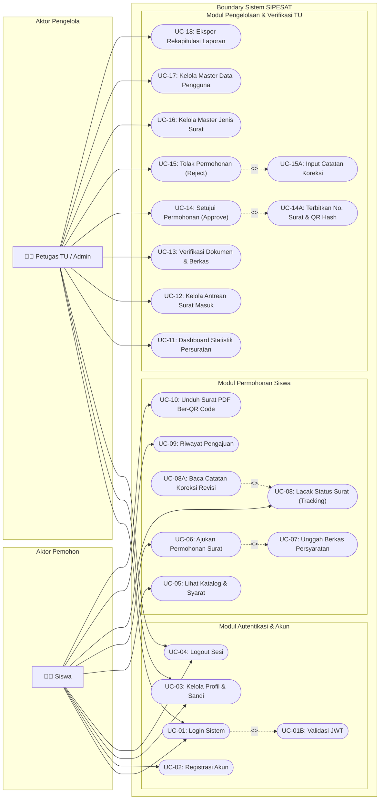

# TUGAS 3 - REKAYASA PERANGKAT LUNAK (RPL)
**PERANCANGAN USE CASE DIAGRAM & MATRIKS HAK AKSES (RBAC)**  
**PROGRAM STUDI TEKNIK INFORMATIKA - FTIK UNIVERSITAS INDRAPRASTA PGRI (UNINDRA)**  
**TAHUN AKADEMIK 2026/2027**

---

### IDENTITAS KELOMPOK (KELOMPOK RPL 7 / KELAS RPL_XD)
1. **Adam Wahyu Kurniawan** (NPM: 202343500510) - *Lead System Architect & Software Engineer*
2. **Fathu Rahman** (NPM: 202343500467) - *Business Analyst & Requirements Engineer*
3. **Surya Edi Saputra** (NPM: 202343500468) - *Quality Assurance & Technical Writer*
4. **Rizqi Muh. Al Hakimi** (NPM: 202343500449) - *Database Specialist & UI/UX*

* **Nama Proyek Perangkat Lunak:**  
  *Sistem Informasi Pengajuan Surat Siswa Berbasis Web (SIPESAT)*
* **Studi Kasus:**  
  Pelayanan Administrasi Persuratan Siswa & Tata Usaha Sekolah Menengah
* **Landasan Acuan Dokumen:**  
  * Dokumen Spesifikasi Kebutuhan Perangkat Lunak (SRS) Standar IEEE Std 830-1998 / Karl Wiegers (Tugas 2)
  * Modul Pembelajaran RPL Pertemuan 03 & 04 (UML Use Case Modeling)
* **Berkas Diagram Draw.io Terkait:**  
  `tugas-3-usecase.drawio` *(2 Tab: Use Case Diagram & RBAC Access Matrix)*

---

## BAB I: PENDAHULUAN & GAMBARAN UMUM SISTEM

### 1.1 Deskripsi Proyek SIPESAT
Sistem Informasi Pengajuan Surat Siswa Berbasis Web (**SIPESAT**) adalah sistem perangkat lunak yang dirancang untuk memodernisasi dan mengotomatisasi rantai birokrasi pengajuan surat keterangan di lingkungan sekolah menengah. Sebelum adanya sistem ini, siswa harus datang langsung ke ruang Tata Usaha (TU), mengisi formulir kertas manual, dan menunggu proses verifikasi berhari-hari tanpa kejelasan status.

SIPESAT memotong hambatan tersebut dengan menyediakan portal mandiri daring bagi siswa untuk mengajukan surat, mengunggah berkas persyaratan secara digital, memantau posisi surat secara transparan (*real-time status tracking*), dan mengunduh berkas surat resmi berformat PDF yang telah dilengkapi nomor register resmi serta kode QR tanda tangan elektronik.

### 1.2 Tujuan Pemodelan Use Case Diagram
Use Case Diagram dalam metodologi Unified Modeling Language (UML) berfungsi memetakan fungsi-fungsi sistem (fungsionalitas) dari perspektif pengguna eksternal (*actor*). Tujuan utama dari pemodelan Use Case pada sistem SIPESAT adalah:
1. Mendefinisikan batasan sistem (*system boundary*) secara tegas.
2. Mengidentifikasi seluruh aktor yang berinteraksi langsung dengan sistem.
3. Memetakan kebutuhan fungsional perangkat lunak ke dalam unit-unit fungsionalitas diskret (*use cases*).
4. Menjelaskan relasi dependensi antarfungsi menggunakan stereotype `<<include>>` (keharusan) dan `<<extend>>` (perluasan opsional).

---

## BAB II: PERANCANGAN USE CASE DIAGRAM SIPESAT

### 2.1 Identifikasi Aktor Sistem
Sistem SIPESAT menerapkan pemisahan tugas berbasis peran (Role-Based Access Control) yang terdiri dari 2 aktor utama:
1. **Siswa (Aktor Pemohon)**: Aktor peserta didik yang terdaftar resmi di sekolah. Bertanggung jawab mengajukan permohonan surat secara mandiri, melampirkan berkas persyaratan sah, memantau status persuratan, dan mengunduh dokumen akhir.
2. **Petugas TU / Admin (Aktor Pengelola & Verifikator)**: Aktor staf administrasi sekolah yang bertugas memverifikasi keabsahan dokumen permohonan, menerbitkan nomor register/agenda surat keluar, mengelola katalog template surat, memelihara master data akun, serta mengekspor rekapitulasi laporan bulanan.

---

### 2.2 Daftar Use Case Terdefinisi

| Kode UC | Nama Use Case | Aktor Utama | Deskripsi Singkat |
|:---:|---|:---:|---|
| **UC-01** | Login ke Sistem | Siswa, Petugas TU | Otentikasi akun pengguna menggunakan NISN/NIP dan kata sandi terenkripsi. |
| **UC-01B** | Validasi Token JWT | Sistem (Include) | Pengecekan keabsahan tanda tangan token JSON Web Token pada setiap request rute terproteksi. |
| **UC-02** | Registrasi Akun Mandiri | Siswa | Pendaftaran akun baru siswa dengan verifikasi keabsahan NISN ke database induk siswa. |
| **UC-03** | Kelola Profil & Sandi | Siswa, Petugas TU | Pembaharuan nomor kontak telepon, email aktif, dan pergantian kata sandi akun. |
| **UC-04** | Logout Sesi | Siswa, Petugas TU | Penghapusan cookie sesi HttpOnly dan pencabutan (*invalidation*) token aktif di server. |
| **UC-05** | Lihat Katalog & Syarat Surat | Siswa | Eksplorasi daftar jenis surat yang tersedia beserta panduan berkas pendukung wajib. |
| **UC-06** | Mengajukan Permohonan Surat | Siswa | Pengisian formulir keperluan, penentuan tujuan pembuatan surat, dan pengiriman draf. |
| **UC-07** | Unggah Berkas Persyaratan | Siswa (Include) | Pengunggahan file bukti pendukung (PDF/JPG, batas maksimum 2 MB) ke penyimpanan aman. |
| **UC-08** | Melacak Status Surat (*Tracking*) | Siswa | Pemantauan posisi proses dokumen secara live: Diajukan $\rightarrow$ Diverifikasi $\rightarrow$ Disetujui $\rightarrow$ Selesai. |
| **UC-08A** | Periksa Catatan Koreksi Revisi | Siswa (Extend) | Pembacaan feedback catatan alasan penolakan berkas dan instruksi perbaikan dari petugas TU. |
| **UC-09** | Riwayat Arsip Pengajuan | Siswa | Peninjauan seluruh rekam jejak surat yang pernah diajukan di masa lalu. |
| **UC-10** | Unduh Surat Resmi Ber-QR Code | Siswa | Pengunduhan stream berkas PDF berkop resmi sekolah yang dilengkapi QR Code verifikasi. |
| **UC-11** | Akses Dashboard Statistik TU | Petugas TU | Tinjauan metrik operasional: jumlah surat masuk, menunggu verifikasi, selesai, dan ditolak. |
| **UC-12** | Kelola Antrean Permohonan Masuk | Petugas TU | Pengurutan dan penyaringan permohonan surat masuk berdasarkan tanggal dan tingkat urgensi. |
| **UC-13** | Verifikasi Kelayakan Berkas Siswa | Petugas TU | Pemeriksaan isi berkas unggahan siswa terhadap kebenaran data registrasi sekolah. |
| **UC-14** | Setujui Permohonan (*Approve*) | Petugas TU | Pengesahan administratif surat permohonan yang telah memenuhi seluruh syarat legalitas. |
| **UC-14A** | Terbitkan Nomor Surat & QR Hash | Petugas TU (Include) | Generate nomor agenda resmi sekolah otomatis dan pembuatan hash kriptografis untuk QR Code. |
| **UC-15** | Tolak Permohonan (*Reject*) | Petugas TU | Penolakan permohonan yang tidak memenuhi syarat atau berkas buram/rusak. |
| **UC-15A** | Input Catatan Instruksi Revisi | Petugas TU (Include) | Penyusunan catatan tertulis mengenai kekurangan berkas untuk ditindaklanjuti oleh siswa. |
| **UC-16** | Kelola Master Jenis Surat | Petugas TU | Manajemen penambahan jenis surat baru, perubahan syarat wajib, dan template isi naskah. |
| **UC-17** | Kelola Master Data Siswa & Akun | Petugas TU | Pengawasan status akun pengguna, reset kata sandi bermasalah, dan aktivasi akun baru. |
| **UC-18** | Cetak / Ekspor Rekapitulasi Laporan | Petugas TU | Pembuatan laporan periodik rekapitulasi persuratan ke dalam format spreadsheet Excel atau PDF. |

---

### 2.3 Visualisasi Diagram Use Case (Mermaid)

---

### 2.4 Spesifikasi Skenario Use Case Utama

#### A. Skenario UC-06: Mengajukan Permohonan Surat
* **Aktor Utama**: Siswa
* **Kondisi Awal (*Pre-conditions*)**: Siswa telah berhasil melakukan login dan akun berstatus aktif.
* **Kondisi Akhir (*Post-conditions*)**: Permohonan tercatat di database dengan status `MENUNGGU_VERIFIKASI` dan kode resi diterbitkan.
* **Alur Utama (*Basic Flow*)**:
  1. Siswa mengakses menu *"Pengajuan Surat"*.
  2. Sistem menampilkan daftar pilihan template surat (Keterangan Aktif, Beasiswa, Kelakuan Baik, Legalisir).
  3. Siswa memilih jenis surat yang dibutuhkan.
  4. Sistem memuat formulir input alasan keperluan dan syarat berkas wajib yang harus dilampirkan.
  5. Siswa menginput data keperluan dan memilih berkas dokumen scan pendukung (*UC-07*).
  6. Siswa menekan tombol *"Kirim Permohonan"*.
  7. Sistem memvalidasi kelengkapan form dan memastikan ukuran berkas $\le 2\text{ MB}$.
  8. Sistem menyimpan record pengajuan, meng-upload file ke direktori aman, dan menerbitkan nomor resi tiket.
  9. Sistem menampilkan konfirmasi sukses beserta kode resi pelacakan.
* **Alur Alternatif (*Alternative Flow*)**:
  * 7a. Jika berkas lebih dari 2 MB atau format bukan PDF/JPG, sistem menolak pengiriman dan menampilkan pesan peringatan merah. Siswa diminta mengunggah ulang dokumen yang sesuai.

#### B. Skenario UC-13 & UC-14: Verifikasi & Persetujuan Permohonan
* **Aktor Utama**: Petugas TU / Admin
* **Kondisi Awal**: Terdapat permohonan masuk dengan status `MENUNGGU_VERIFIKASI`.
* **Kondisi Akhir**: Surat disahkan dengan nomor register resmi dan kode QR, siap diunduh siswa.
* **Alur Utama**:
  1. Petugas TU membuka menu *"Antrean Permohonan Masuk"*.
  2. Sistem menampilkan tabel daftar permohonan surat terurut dari tanggal masuk terlama.
  3. Petugas TU memilih satu berkas permohonan untuk ditinjau.
  4. Sistem menyajikan rincian permohonan dan penampil (*viewer*) berkas lampiran siswa.
  5. Petugas TU memvalidasi kesesuaian data siswa dan keabsahan berkas.
  6. Petugas TU mengklik tombol *"Setujui Permohonan"*.
  7. Sistem mengeksekusi *UC-14A*: menghasilkan nomor surat keluar resmi sesuai format penomoran agenda sekolah dan membentuk kode hash SHA-256 untuk stempel QR Code.
  8. Status surat diperbarui menjadi `SELESAI_SIAP_UNDUH`.
  9. Sistem mengirimkan sinyal notifikasi ke dashboard akun siswa bersangkutan.
* **Alur Alternatif**:
  * 6a. Jika berkas buram atau tidak valid, Petugas TU memilih tombol *"Tolak / Minta Revisi"*.
  * 6b. Sistem mengeksekusi *UC-15A*: mewajibkan Petugas TU menuliskan alasan penolakan pada kotak teks catatan.
  * 6c. Status diperbarui menjadi `DITOLAK_PERLU_REVISI`, dan catatan koreksi langsung terhubung ke pelacakan siswa.

---

## BAB III: MATRIKS HAK AKSES (ROLE-BASED ACCESS CONTROL / RBAC)

Untuk menjamin keamanan sistem dan integritas data persuratan sekolah, setiap fungsi sistem dipagari oleh otorisasi berbasis peran:

| No | Modul & Nama Use Case | Siswa | Petugas TU / Admin |
|:---:|---|:---:|:---:|
| 1 | **UC-01**: Login ke Sistem | ✅ Ya | ✅ Ya |
| 2 | **UC-02**: Registrasi Akun Siswa Baru | ✅ Ya | ❌ Tidak |
| 3 | **UC-03**: Kelola Profil Pribadi & Ganti Sandi | ✅ Ya | ✅ Ya |
| 4 | **UC-04**: Logout Sesi Pengguna | ✅ Ya | ✅ Ya |
| 5 | **UC-05**: Akses Katalog Jenis Surat & Panduan Syarat | ✅ Ya | ✅ Ya (Kelola) |
| 6 | **UC-06**: Pengisian Formulir Permohonan Surat Baru | ✅ Ya | ❌ Tidak |
| 7 | **UC-07**: Unggah Berkas Persyaratan (PDF/JPG Max 2MB) | ✅ Ya | ❌ Tidak |
| 8 | **UC-08**: Pelacakan Status Berkas (*Real-time Stepper*) | ✅ Ya | ❌ Tidak |
| 9 | **UC-09**: Riwayat Seluruh Arsip Pengajuan Mandiri | ✅ Ya | ❌ Tidak |
| 10 | **UC-10**: Unduh Berkas PDF Surat Resmi Ber-QR Code | ✅ Ya | ✅ Ya |
| 11 | **UC-11**: Akses Dashboard Statistik Operasional TU | ❌ Tidak | ✅ Ya |
| 12 | **UC-12**: Kelola Antrean Seluruh Permohonan Masuk | ❌ Tidak | ✅ Ya |
| 13 | **UC-13**: Verifikasi Keabsahan Dokumen Siswa | ❌ Tidak | ✅ Ya |
| 14 | **UC-14**: Persetujuan Permohonan (*Approve*) | ❌ Tidak | ✅ Ya |
| 15 | **UC-15**: Penolakan Permohonan & Catatan Revisi (*Reject*) | ❌ Tidak | ✅ Ya |
| 16 | **UC-16**: Kelola Master Katalog & Persyaratan Surat | ❌ Tidak | ✅ Ya |
| 17 | **UC-17**: Kelola Master Akun Pengguna & Reset Sandi | ❌ Tidak | ✅ Ya |
| 18 | **UC-18**: Ekspor Rekapitulasi Laporan Bulanan (Excel/PDF) | ❌ Tidak | ✅ Ya |

---

## BAB IV: KESIMPULAN & PENUTUP

Perancangan Use Case Diagram dan Matriks Hak Akses (RBAC) pada sistem **SIPESAT** telah diselaraskan secara komprehensif dengan:
1. **SRS Standar IEEE Std 830-1998 (Tugas 2)**: Menjaga konsistensi identifikasi fungsionalitas sistem dari spesifikasi awal.
2. **Kaidah Akademik UNINDRA**: Mengimplementasikan batasan sistem yang tegas, relasi use case baku (`<<include>>` dan `<<extend>>`), serta alur skenario formal yang terperinci.
3. **Penyelarasan Hulu-ke-Hilir**: Seluruh use case yang dimodelkan pada dokumen ini menjadi landasan langsung dalam penyusunan **Activity Diagram & Sequence Diagram (Tugas 4)** serta **State Machine Diagram (Tugas 5)**.

Diagram visual interaktif yang dapat disunting secara langsung telah diintegrasikan pada berkas Draw.io resmi:
* **Berkas Draw.io**: `tugas-3-usecase.drawio` *(Format XML Multi-Tab Native Draw.io / Diagrams.net)*.
