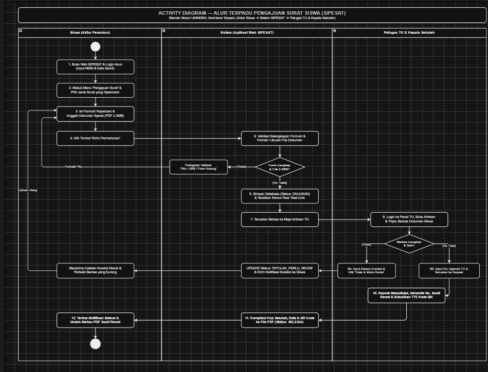
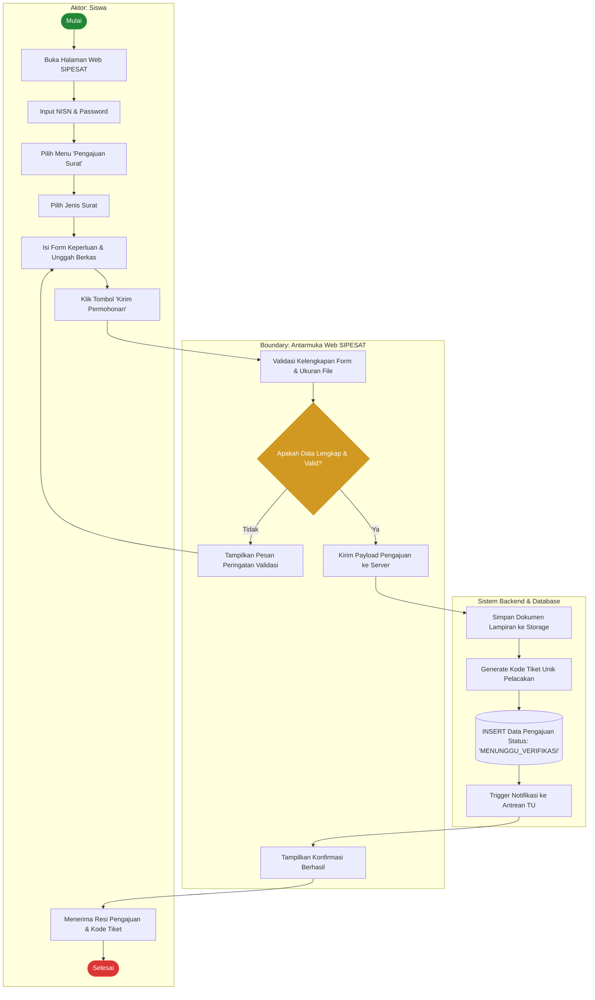
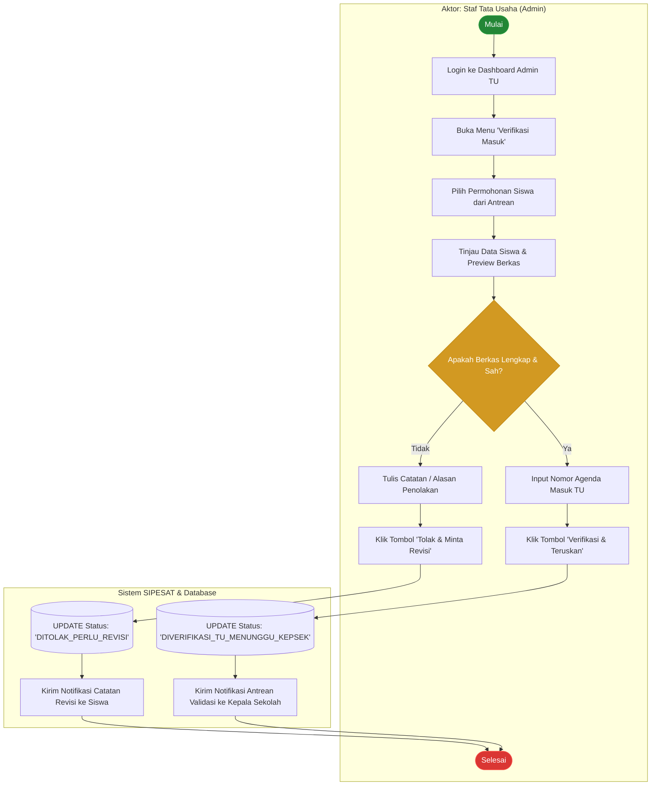
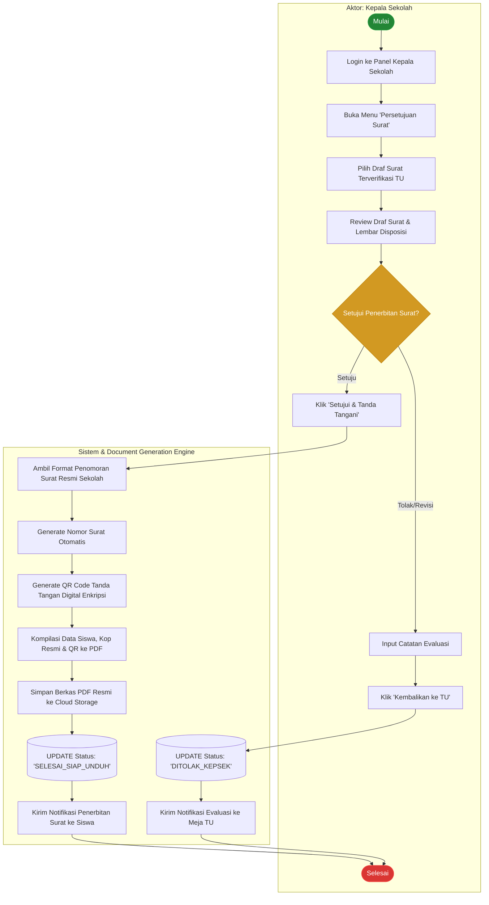
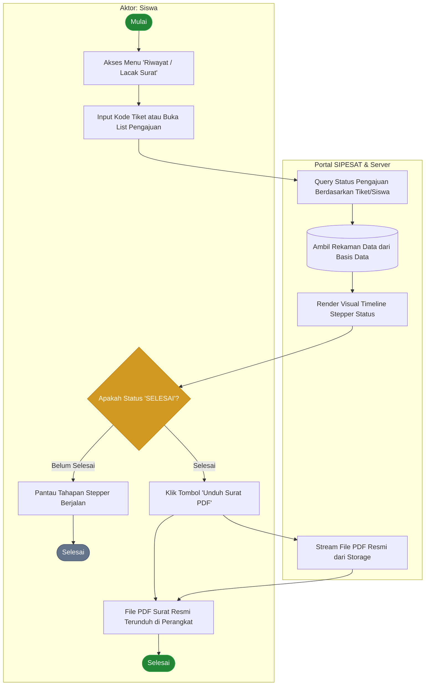
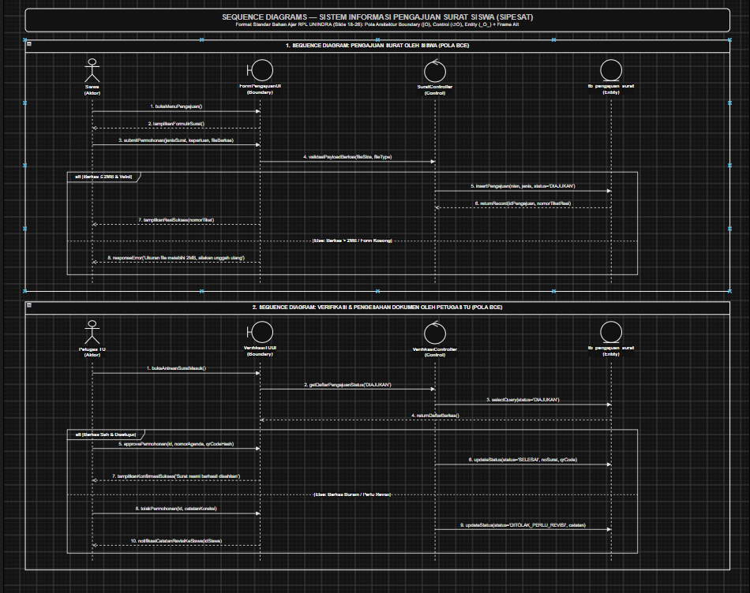
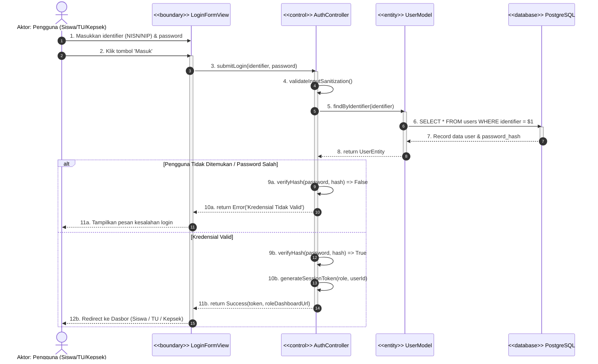
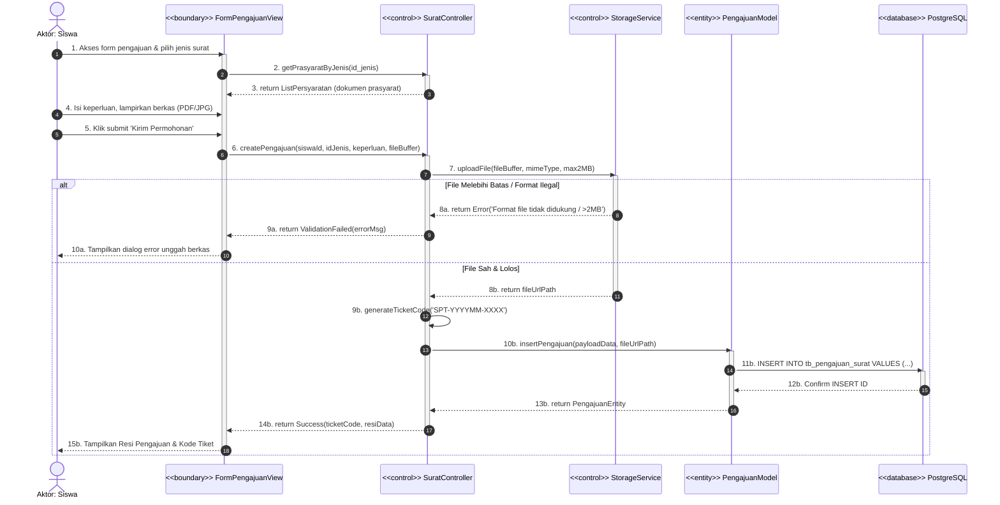
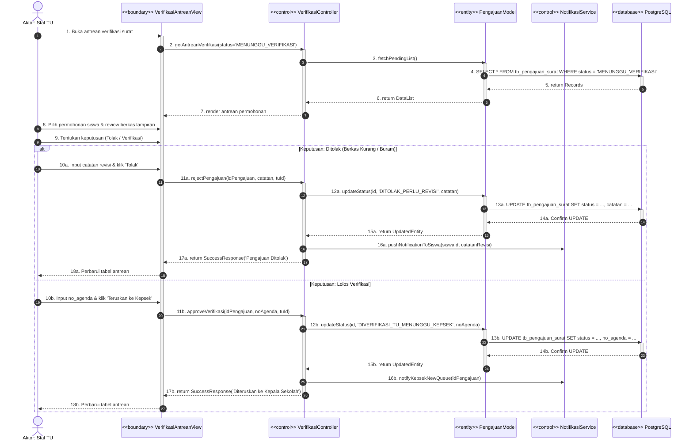
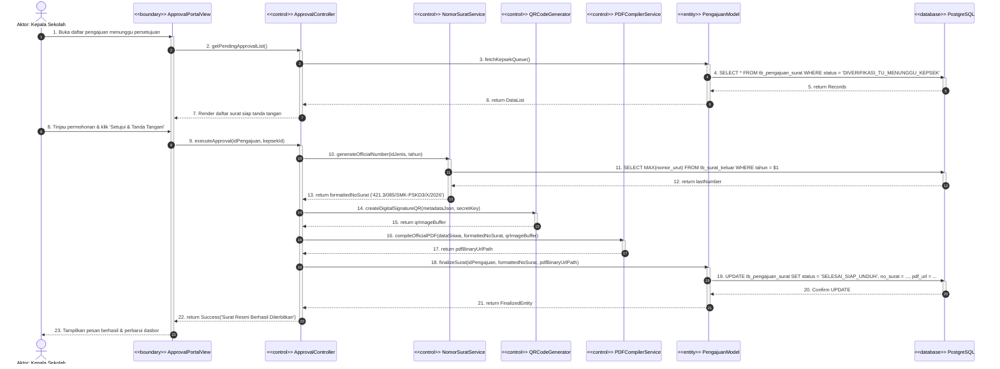

# TUGAS 4 - REKAYASA PERANGKAT LUNAK (RPL)
**PERANCANGAN ACTIVITY DIAGRAM DAN SEQUENCE DIAGRAM**
**PROGRAM STUDI TEKNIK INFORMATIKA - FTIK UNIVERSITAS INDRAPRASTA PGRI (UNINDRA)**
**TAHUN AKADEMIK 2026/2027**

---

### IDENTITAS KELOMPOK (KELOMPOK RPL 7)
1. **Adam Wahyu Kurniawan** - 202343500510
2. **Fathu Rahman** - 202343500467
3. **Surya Edi Saputra** - 202343500468
4. **Rizqi Muh. Al Hakimi** - 202343500449

* **Nama Proyek Perangkat Lunak:**  
  *Sistem Informasi Pengajuan Surat Siswa Berbasis Web (SIPESAT)*
* **Studi Kasus:**  
  Pelayanan Administrasi Persuratan Siswa & Tata Usaha Sekolah
* **Landasan Acuan:**  
  Dokumen Spesifikasi Kebutuhan Perangkat Lunak (SRS) Standar IEEE Std 830-1998 / Karl Wiegers (Tugas 2)

---

## BAB I: PENDAHULUAN & GAMBARAN UMUM SISTEM

### 1.1 Deskripsi Proyek SIPESAT
Sistem Informasi Pengajuan Surat Siswa Berbasis Web (SIPESAT) adalah sistem yang kami kembangkan untuk mempermudah proses pelayanan administrasi persuratan bagi siswa di lingkungan sekolah. Pada sistem sebelumnya, siswa harus datang langsung ke ruang Tata Usaha (TU) untuk meminta form kertas dan menunggu proses pembuatan surat yang memakan waktu cukup lama. Melalui SIPESAT, siswa dapat mengajukan surat kapan saja secara online, memantau posisi suratnya, dan mengunduh surat resmi yang sudah disetujui.

Sistem ini membagi hak akses ke dalam 3 (tiga) peran pengguna (aktor) utama:
1. **Siswa**: Mengajukan permohonan surat secara mandiri, melampirkan berkas persyaratan (maksimal 2 MB), memantau perkembangan status surat, serta mengunduh surat PDF yang telah disahkan.
2. **Staf Tata Usaha (TU)**: Memeriksa dan memverifikasi kelengkapan berkas yang diajukan siswa, memberikan nomor agenda surat masuk, dan meneruskan berkas yang valid ke Kepala Sekolah (atau menolaknya dengan catatan revisi jika berkas belum lengkap).
3. **Kepala Sekolah**: Memeriksa draf surat yang sudah diverifikasi TU, memberikan persetujuan (approval), dan mengesahkan surat dengan tanda tangan elektronik berbasis kode QR.

### 1.2 Tujuan Pemodelan UML
Pemodelan UML (Unified Modeling Language) pada dokumen ini disusun untuk menjelaskan alur sistem dari dua sudut pandang:
1. **Activity Diagram**: Digunakan untuk memetakan alur aktivitas kerja (workflow) pada sistem, baik yang dilakukan oleh pengguna maupun proses internal yang dilakukan oleh sistem.
2. **Sequence Diagram**: Digunakan untuk menggambarkan interaksi antarkomponen program berdasarkan urutan waktu pemanggilan fungsi, dengan membagi komponen ke dalam pola *Boundary-Control-Entity (BCE)* agar struktur kode lebih rapi.

---

## BAB II: PERANCANGAN ACTIVITY DIAGRAM

Activity Diagram menggambarkan urutan alur kerja dari suatu aktivitas pada sistem SIPESAT, mulai dari titik awal (start), aksi pengguna, percabangan keputusan (decision), hingga selesai.

Berikut adalah diagram alur kerja terpadu (Swimlane Terpadu Siswa, Sistem SIPESAT, dan Petugas TU / Kepala Sekolah) standar modul RPL UNINDRA Pertemuan 04:

*Gambar 2.1: Activity Diagram Alur Terpadu SIPESAT Standar UNINDRA (100% Bebas Tabrakan)*

---

### 2.1 Activity Diagram 1: Alur Pengajuan Surat oleh Siswa
Diagram ini menggambarkan alur saat siswa masuk ke sistem, memilih jenis surat, mengisi keperluan, mengunggah dokumen persyaratan, hingga mendapatkan bukti resi nomor tiket.

#### Uraian Alur Kerja Activity Diagram 1:
1. Siswa membuka website SIPESAT lalu login menggunakan NISN dan kata sandi.
2. Siswa masuk ke menu "Pengajuan Surat" dan memilih jenis surat yang dibutuhkan (misalnya Surat Keterangan Siswa Aktif, Rekomendasi Beasiswa, dsb).
3. Siswa mengisi keperluan surat serta mengunggah file berkas persyaratan yang diminta (format PDF/JPG dengan ukuran maksimal 2 MB).
4. Siswa menekan tombol "Kirim Permohonan".
5. Sistem memeriksa kelengkapan isian form dan ukuran file. Jika file tidak sesuai atau melebihi 2 MB, sistem memunculkan pesan kesalahan agar siswa memperbaiki unggahannya.
6. Jika data sudah lengkap dan valid, sistem menyimpan berkas lampiran, membuat kode tiket unik (misal: `SPT-202610-0042`), dan menyimpan permohonan ke database dengan status awal `MENUNGGU_VERIFIKASI`.
7. Sistem menampilkan resi tanda terima pengajuan beserta kode tiket yang dapat disimpan oleh siswa untuk melacak progres surat.

---

### 2.2 Activity Diagram 2: Alur Verifikasi Berkas oleh Staf Tata Usaha (TU)
Diagram ini menggambarkan alur kerja staf TU dalam memeriksa kelengkapan berkas yang diajukan oleh siswa, menentukan keputusan apakah permohonan disetujui atau ditolak, dan memberikan nomor agenda surat masuk.

#### Uraian Alur Kerja Activity Diagram 2:
1. Staf TU membuka website SIPESAT dan melakukan login ke panel admin TU.
2. Staf TU membuka menu "Verifikasi Masuk" untuk melihat daftar permohonan surat yang masuk dari siswa.
3. Staf TU memilih salah satu permohonan dan melihat pratinjau (preview) berkas lampiran yang diunggah.
4. Staf TU memeriksa apakah berkas persyaratan sudah lengkap, jelas terbaca, dan sah.
5. Jika berkas tidak lengkap atau buram, staf TU menuliskan catatan alasan penolakan dan menekan tombol "Tolak & Minta Revisi". Status diubah menjadi `DITOLAK_PERLU_REVISI` dan sistem otomatis mengirimkan notifikasi ke siswa.
6. Jika berkas sudah lengkap dan benar, staf TU memasukkan nomor agenda masuk TU lalu menekan tombol "Verifikasi & Teruskan". Status diubah menjadi `DIVERIFIKASI_TU_MENUNGGU_KEPSEK` dan permohonan diteruskan ke antrean Kepala Sekolah.

---

### 2.3 Activity Diagram 3: Alur Persetujuan oleh Kepala Sekolah
Diagram ini menggambarkan alur kerja Kepala Sekolah dalam meninjau draf permohonan surat yang telah diverifikasi TU, memberikan persetujuan, hingga surat resmi ber-QR Code berhasil dibuat oleh sistem.

#### Uraian Alur Kerja Activity Diagram 3:
1. Kepala Sekolah login ke panel Kepala Sekolah dan membuka menu "Persetujuan Surat".
2. Kepala Sekolah memilih draf permohonan surat yang sebelumnya telah diverifikasi oleh staf TU.
3. Kepala Sekolah memeriksa isi permohonan. Jika ada data yang kurang tepat, Kepala Sekolah dapat mengisi catatan evaluasi dan mengembalikannya ke meja TU dengan status `DITOLAK_KEPSEK`.
4. Jika disetujui, Kepala Sekolah menekan tombol "Setujui & Tanda Tangani".
5. Sistem secara otomatis menghitung nomor urut surat keluar resmi sekolah (misal: `421.3/085/SMK-PSKD3/X/2026`).
6. Sistem membuat tanda tangan elektronik berupa kode QR yang berisi identitas pengesahan (nama Kepala Sekolah, NIP, tanggal terbit, dan tautan verifikasi keaslian dokumen).
7. Sistem menyatukan kop resmi sekolah, isi permohonan, nomor surat, dan kode QR ke dalam format PDF resmi, lalu memperbarui status menjadi `SELESAI_SIAP_UNDUH`.

---

### 2.4 Activity Diagram 4: Alur Pelacakan Status & Unduh Surat oleh Siswa
Diagram ini menggambarkan alur siswa dalam memantau perkembangan surat yang diajukannya melalui indikator tahapan (stepper) hingga mengunduh dokumen PDF resmi.

#### Uraian Alur Kerja Activity Diagram 4:
1. Siswa membuka menu "Riwayat / Lacak Surat" pada portal SIPESAT.
2. Siswa memasukkan kode tiket unik atau langsung memilih dari daftar riwayat surat yang pernah diajukan.
3. Sistem mengambil data dari database dan menampilkan tahapan status secara visual (stepper): Diajukan → Verifikasi TU → Persetujuan Kepsek → Selesai.
4. Jika proses belum selesai, siswa dapat memantau posisi suratnya kapan saja tanpa perlu datang langsung ke sekolah.
5. Jika status sudah `SELESAI_SIAP_UNDUH`, tombol "Unduh Surat PDF" akan aktif dan siswa dapat langsung mendownload surat resmi tersebut ke perangkatnya.

---

## BAB III: PERANCANGAN SEQUENCE DIAGRAM

Sequence Diagram digunakan untuk menggambarkan interaksi antarkomponen objek di dalam sistem berdasarkan urutan waktu. Untuk mempermudah rancangan teknis dan pemisahan logika koding, pemodelan ini dibagi ke dalam 3 jenis komponen sesuai konsep **Boundary-Control-Entity (BCE)**:
* **<<boundary>> (Antarmuka / Form)**: Komponen tampilan web tempat pengguna berinteraksi langsung (seperti form login atau form isian surat).
* **<<control>> (Pengontrol Logika)**: Komponen program yang mengatur jalannya logika bisnis, validasi data, dan proses pemrosesan fungsi.
* **<<entity>> & <<database>> (Model Data & Basis Data)**: Komponen model data dan tabel pada basis data (PostgreSQL) tempat informasi disimpan secara permanen.

Berikut adalah rancangan visual Sequence Diagram Pengajuan Surat Siswa & Verifikasi Berkas TU standar BCE lengkap dengan frame `alt` alternatif:

*Gambar 3.1: Sequence Diagram Pengajuan & Verifikasi Dokumen Pola BCE (100% Bebas Tabrakan)*

---

### 3.1 Sequence Diagram 1: Alur Login Multi-Pengguna (RBAC)
Memodelkan verifikasi identitas pengguna (Siswa, TU, Kepala Sekolah) dan inisiasi sesi terotorisasi.

#### Penjelasan Alur Program Sequence Diagram 1:
Pengguna (Siswa, Staf TU, atau Kepala Sekolah) memasukkan NISN/NIP dan kata sandi pada halaman `LoginFormView`. Komponen `AuthController` memeriksa validitas input dan memanggil `UserModel` untuk mencari data pengguna di basis data. Jika kata sandi cocok dengan data yang tersimpan, controller membuatkan token sesi (JWT) yang menentukan hak akses pengguna, lalu mengarahkan pengguna ke halaman dasbor masing-masing.

---

### 3.2 Sequence Diagram 2: Alur Pengajuan Surat & Unggah Berkas oleh Siswa
Memodelkan pengisian formulir permohonan surat oleh siswa, penyimpanan berkas ke media penyimpanan, dan pencatatan tiket ke basis data.

#### Penjelasan Alur Program Sequence Diagram 2:
Siswa membuka form permohonan surat melalui `FormPengajuanView`. Saat jenis surat dipilih, `SuratController` mengambil daftar persyaratan yang dibutuhkan. Ketika form dan berkas di-submit, `StorageService` memeriksa format dan batas ukuran file (maksimal 2 MB). Setelah berkas berhasil disimpan, `SuratController` membuat kode tiket unik dan `PengajuanModel` mencatat permohonan ke basis data dengan status awal `MENUNGGU_VERIFIKASI`, kemudian sistem menampilkan bukti tanda terima beserta kode tiket ke siswa.

---

### 3.3 Sequence Diagram 3: Alur Verifikasi Berkas oleh Staf Tata Usaha (TU)
Memodelkan peninjauan berkas lampiran siswa, disposisi persetujuan atau penolakan administratif, dan pembaruan catatan riwayat.

#### Penjelasan Alur Program Sequence Diagram 3:
Staf TU membuka `VerifikasiAntreanView` untuk melihat antrean permohonan surat masuk. `VerifikasiController` mengelola dua kemungkinan alur: jika berkas ditolak karena kurang atau buram, controller mencatat alasan penolakan dan memicu `NotifikasiService` agar siswa memperbaiki lampiran; jika berkas sah, staf TU memasukkan nomor agenda masuk dan status permohonan diubah menjadi `DIVERIFIKASI_TU_MENUNGGU_KEPSEK` untuk diteruskan ke antrean Kepala Sekolah.

---

### 3.4 Sequence Diagram 4: Alur Persetujuan Kepala Sekolah & Penerbitan Surat PDF
Memodelkan pengesahan dokumen oleh pimpinan sekolah, pembentukan nomor surat resmi berurutan, pembuatan kode QR enkripsi, dan kompilasi berkas PDF ber-kop resmi.

#### Penjelasan Alur Program Sequence Diagram 4:
Ketika Kepala Sekolah menyetujui surat melalui `ApprovalPortalView`, `ApprovalController` memanggil tiga fungsi layanan secara berurutan: pertama, `NomorSuratService` mengambil nomor urut surat resmi terbaru; kedua, `QRCodeGenerator` membuat gambar kode QR sebagai tanda tangan digital resmi; ketiga, `PDFCompilerService` menggabungkan kop surat sekolah, data permohonan, dan kode QR menjadi file dokumen PDF resmi. Setelah berkas siap, `PengajuanModel` memperbarui status surat di database menjadi `SELESAI_SIAP_UNDUH`.

---

## BAB IV: MATRIKS PENELUSURAN KEBUTUHAN (TRACEABILITY MATRIX)

Tabel matriks berikut digunakan untuk memastikan bahwa setiap kebutuhan fungsional yang sudah disusun pada Dokumen SRS (Tugas 2) benar-benar sudah digambarkan pada rancangan diagram Tugas 4 ini:

| Kode Kebutuhan (SRS) | Deskripsi Kebutuhan Fungsional | Activity Diagram Terkait | Sequence Diagram Terkait |
|---|---|:---:|:---:|
| **REQ-F-01** | Autentikasi Pengguna & Hak Akses Berbasis Peran (RBAC) | Activity Diagram 1, 2, 3 | **Sequence Diagram 1** |
| **REQ-F-02** | Pengajuan Surat Mandiri & Unggah Berkas Persyaratan | **Activity Diagram 1** | **Sequence Diagram 2** |
| **REQ-F-03** | Verifikasi & Disposisi Kelengkapan Berkas oleh Staf TU | **Activity Diagram 2** | **Sequence Diagram 3** |
| **REQ-F-04** | Validasi Eksekutif & Persetujuan Kepala Sekolah | **Activity Diagram 3** | **Sequence Diagram 4** |
| **REQ-F-05** | Penomoran Surat Otomatis & Generator Dokumen PDF ber-QR | **Activity Diagram 3** | **Sequence Diagram 4** |
| **REQ-F-06** | Pelacakan Status (*Stepper Tracker*) & Unduh Surat Resmi | **Activity Diagram 4** | **Sequence Diagram 2 & 4** |

---

## BAB V: KESIMPULAN

Berdasarkan hasil perancangan Activity Diagram dan Sequence Diagram untuk sistem SIPESAT pada Tugas 4 ini, dapat kami simpulkan bahwa:
1. Seluruh alur pelayanan persuratan siswa pada sistem SIPESAT, mulai dari pengajuan mandiri oleh siswa, verifikasi berkas oleh staf TU, persetujuan dan pengesahan tanda tangan elektronik oleh Kepala Sekolah, hingga pelacakan dan pengunduhan surat telah berhasil dimodelkan dengan runtut.
2. Penggunaan pembagian kolom (swimlane) pada Activity Diagram mempermudah pembagian hak akses dan batasan tanggung jawab antara siswa, staf TU, kepala sekolah, dan sistem.
3. Penerapan konsep Boundary-Control-Entity (BCE) pada Sequence Diagram mempermudah pemahaman mengenai pemisahan antarmuka (view), logika pemrosesan (controller), dan tabel database (model) yang akan diimplementasikan saat koding aplikasi.
4. Rancangan diagram yang dibuat sudah sesuai dan selaras dengan kebutuhan fungsional yang telah diajukan pada dokumen SRS tugas sebelumnya.

---

Jakarta, Oktober 2026  
**Kelompok 7 RPL - Teknik Informatika UNINDRA**
