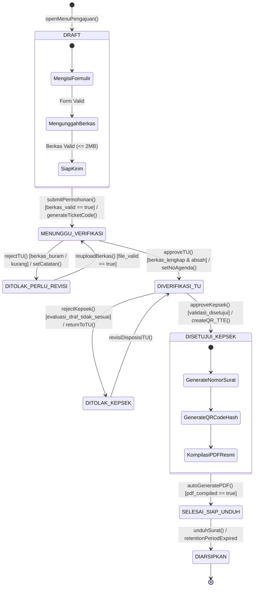
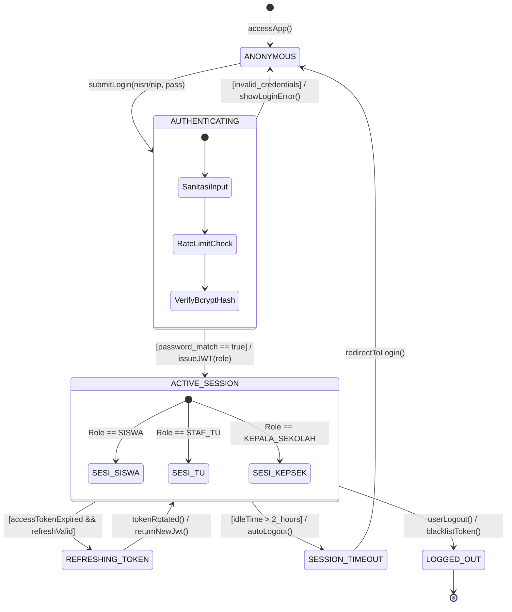

# TUGAS 5 - REKAYASA PERANGKAT LUNAK (RPL)
**PERANCANGAN STATE MACHINE DIAGRAM BERDASARKAN SPESIFIKASI KEBUTUHAN SISTEM**  
**PROGRAM STUDI TEKNIK INFORMATIKA - FTIK UNIVERSITAS INDRAPRASTA PGRI (UNINDRA)**  
**TAHUN AKADEMIK 2026/2027**

---

### IDENTITAS KELOMPOK (KELOMPOK RPL 7 / KELAS RPL_XD)
1. **Adam Wahyu Kurniawan** (NPM: 202343500510) - *Lead System Architect & Software Engineer*
2. **Fathu Rahman** (NPM: 202343500467) - *Business Analyst & Requirements Engineer*
3. **Surya Edi Saputra** (NPM: 202343500468) - *Quality Assurance & Technical Writer*
4. **Rizqi Muh. Al Hakimi** (NPM: 202343500449) - *Database Specialist & UI/UX*

* **Nama Proyek Perangkat Lunak:**  
  *Sistem Informasi Pengajuan Surat Siswa Berbasis Web (SIPESAT)*
* **Studi Kasus:**  
  Pelayanan Administrasi Persuratan Siswa & Tata Usaha Sekolah Menengah
* **Landasan Acuan Dokumen:**  
  * Dokumen Spesifikasi Kebutuhan Perangkat Lunak (SRS) Standar IEEE Std 830-1998 (Tugas 2)
  * Pemodelan Activity Diagram & Sequence Diagram Standar UML 2.5 (Tugas 4)

---

## BAB I: PENDAHULUAN & LANDASAN TEORI

### 1.1 Gambaran Umum Proyek SIPESAT
Sistem Informasi Pengajuan Surat Siswa Berbasis Web (SIPESAT) adalah platform layanan persuratan digital sekolah yang dirancang untuk mengotomatisasi proses birokrasi pengajuan surat keterangan siswa, rekomendasi beasiswa, legalisir, dan dispensasi. Melalui arsitektur Role-Based Access Control (RBAC), sistem melibatkan tiga aktor utama yaitu Siswa, Staf Tata Usaha (TU), dan Kepala Sekolah. Setiap permohonan surat melewati alur hidup formal yang menuntut kepatuhan integritas data, validasi berkas fisik-digital, penomoran berurutan resmi sekolah, dan tanda tangan elektronik (TTE) berbasis kode QR terenkripsi.

### 1.2 Konsep Dasar State Machine Diagram (UML 2.5)
State Machine Diagram (dikenal juga sebagai Statechart Diagram) dalam standar Unified Modeling Language (UML) 2.5 adalah diagram perilaku dinamis yang memodelkan siklus hidup diskret dari suatu objek tunggal, mulai dari inisialisasi awal hingga terminasi akhir. Berbeda dengan Activity Diagram yang memetakan aliran kerja lintas fungsi (workflow) atau Sequence Diagram yang memodelkan pertukaran pesan antarkomponen berurutan waktu, State Machine Diagram berfokus secara eksklusif pada perubahan status keadaan (state) internal suatu entitas akibat rangsangan peristiwa (event).

Elemen-elemen formal yang menyusun State Machine Diagram meliputi:
1. **State (Keadaan)**: Keadaan stabil di mana suatu entitas berada pada kondisi tertentu. Di dalamnya dapat didefinisikan internal behaviors: `entry` (dieksekusi saat masuk state), `do` (aktivitas yang berlangsung selama berada di state), dan `exit` (dieksekusi saat meninggalkan state).
2. **Transition (Transisi)**: Perubahan dari satu keadaan ke keadaan lain yang dipicu oleh stimulus.
3. **Event / Trigger**: Stimulus eksternal atau internal yang memicu terjadinya transisi (misalnya pemanggilan fungsi `submitPermohonan()` atau `approveTU()`).
4. **Guard Condition**: Pernyataan kondisi boolean `[kondisi]` yang wajib bernilai TRUE agar transisi diizinkan dieksekusi oleh sistem.
5. **Action / Effect**: Tindakan komputasi otomatis yang dieksekusi secara instan saat transisi berlangsung (misalnya `/ generateTicketCode()`).
6. **Initial & Final Pseudostates**: Titik awal dimulainya siklus hidup objek (dilambangkan lingkaran hitam penuh `●`) dan titik akhir terminasi objek (dilambangkan lingkaran ganda bullseye `◉`).

---

## BAB II: PERANCANGAN STATE MACHINE DIAGRAM SIPESAT

### 2.1 State Machine Diagram 1: Siklus Hidup Permohonan Surat Siswa (`SuratPengajuan`)
Entitas utama pada sistem SIPESAT adalah objek permohonan surat (direpresentasikan oleh model tabel `tb_pengajuan_surat`). Diagram berikut memodelkan seluruh siklus hidup dokumen permohonan dari pembuatan draf hingga pengarsipan permanen:



#### Uraian Rinci Status Keadaan (State) Surat:
1. **State DRAFT**: Keadaan saat siswa pertama kali membuka form pengajuan di web. Siswa mengisi formulir keperluan dan mengunggah berkas persyaratan (maksimal 2 MB).
2. **State MENUNGGU_VERIFIKASI**: Setelah siswa submit dengan guard `[berkas_valid == true]`. Sistem membuat kode tiket unik (misal: `SPT-202610-0042`), menyuntikkan notifikasi ke antrean TU, dan mengunci form agar tidak diedit.
3. **State DITOLAK_PERLU_REVISI**: Staf TU menolak berkas buram/kurang via `rejectTU()`. Sistem membuka izin revisi upload dan mengirimkan alert notifikasi ke dasbor siswa.
4. **State DIVERIFIKASI_TU**: Staf TU menyetujui berkas via `approveTU()` dan menginput nomor agenda masuk TU. Permohonan diteruskan ke antrean Kepala Sekolah.
5. **State DITOLAK_KEPSEK**: Kepala Sekolah menolak draf surat dengan catatan evaluasi. Draf dikembalikan ke meja TU untuk diperbaiki.
6. **State DISETUJUI_KEPSEK**: Kepala Sekolah menyetujui permohonan. Sistem mengunci persetujuan, membangkitkan hash QR Code TTE, dan mengambil nomor urut surat keluar.
7. **State SELESAI_SIAP_UNDUH**: Mesin kompilasi PDF menyatukan kop sekolah, data siswa, dan kode QR menjadi file PDF resmi ber-watermark siap diunduh.
8. **State DIARSIPKAN**: Surat telah diunduh siswa atau melewati masa simpan aktif, lalu dibekukan permanen ke buku agenda arsip surat keluar digital.

---

### 2.2 State Machine Diagram 2: Siklus Sesi Autentikasi Pengguna Multi-Role (RBAC)
Entitas sesi pengguna (`UserSession`) memegang peranan krusial dalam keamanan sistem persuratan sekolah. Diagram berikut memodelkan siklus autentikasi berbasis JSON Web Token (JWT) dengan pembatasan hak akses berbasis peran (RBAC):



---

## BAB III: TABEL TRANSISI KEADAAN (STATE TRANSITION TABLE)

### Tabel 3.1: Matriks Transisi Keadaan Permohonan Surat Siswa (`tb_pengajuan_surat`)

| State Asal | Event / Trigger | Guard Condition | Action / Effect | State Tujuan |
|---|---|---|---|---|
| **INITIAL (●)** | `openMenuPengajuan()` | `user_authenticated == true` | `initFormPayload()` | **DRAFT** |
| **DRAFT** | `submitPermohonan()` | `form_valid && file_size <= 2MB` | `generateTicketCode(), notifyTU()` | **MENUNGGU_VERIFIKASI** |
| **MENUNGGU_VERIFIKASI** | `rejectTU()` | `berkas_tidak_lengkap \|\| buram` | `setCatatanRevisi(), alertSiswa()` | **DITOLAK_PERLU_REVISI** |
| **DITOLAK_PERLU_REVISI** | `reuploadBerkas()` | `file_revisi_valid == true` | `updateLampiran(), notifyTU()` | **MENUNGGU_VERIFIKASI** |
| **MENUNGGU_VERIFIKASI** | `approveTU()` | `berkas_lengkap_dan_absah == true` | `setNoAgenda(), forwardToKepsek()` | **DIVERIFIKASI_TU** |
| **DIVERIFIKASI_TU** | `rejectKepsek()` | `evaluasi_draf_tidak_sesuai` | `returnDraftToTU(), logNotes()` | **DITOLAK_KEPSEK** |
| **DITOLAK_KEPSEK** | `revisiDisposisiTU()` | `data_disposisi_diperbaiki == true` | `reForwardToKepsek()` | **DIVERIFIKASI_TU** |
| **DIVERIFIKASI_TU** | `approveKepsek()` | `validasi_kepsek_disetujui == true` | `createQR_TTE(), generateNoSurat()` | **DISETUJUI_KEPSEK** |
| **DISETUJUI_KEPSEK** | `autoGeneratePDF()` | `pdf_binary_compiled == true` | `saveToStorage(), notifySiswa()` | **SELESAI_SIAP_UNDUH** |
| **SELESAI_SIAP_UNDUH** | `unduhSurat()` | `retention_period_expired` | `freezeRecordToAgendaArsip()` | **DIARSIPKAN** |

---

## BAB IV: IMPLEMENTASI BASIS DATA & INTEGRASI TEKNIS

### 4.1 Definisi Enum Status pada PostgreSQL (Prisma ORM)
```prisma
// Definisi Enum State Status Pengajuan pada prisma/schema.prisma
enum StatusPengajuan {
  DRAFT                        // Siswa menyusun formulir
  MENUNGGU_VERIFIKASI          // Berkas masuk antrean TU
  DITOLAK_PERLU_REVISI         // TU meminta perbaikan berkas
  DIVERIFIKASI_TU_MENUNGGU_KEPSEK // Lolos verifikasi TU, antrean Kepsek
  DITOLAK_KEPSEK               // Kepsek meminta evaluasi draf
  DISETUJUI_KEPSEK             // Kepsek menyetujui penerbitan
  SELESAI_SIAP_UNDUH           // PDF resmi & QR Code siap diunduh
  DIARSIPKAN                   // Dokumen tersimpan permanen
}
```

### 4.2 State Guard Logic pada Service Backend
```typescript
// Validasi Guard State Machine pada backend/service/SuratService.ts
export function validateStateTransition(current: StatusPengajuan, next: StatusPengajuan): boolean {
  const allowedTransitions: Record<StatusPengajuan, StatusPengajuan[]> = {
    DRAFT: ['MENUNGGU_VERIFIKASI'],
    MENUNGGU_VERIFIKASI: ['DITOLAK_PERLU_REVISI', 'DIVERIFIKASI_TU_MENUNGGU_KEPSEK'],
    DITOLAK_PERLU_REVISI: ['MENUNGGU_VERIFIKASI'],
    DIVERIFIKASI_TU_MENUNGGU_KEPSEK: ['DITOLAK_KEPSEK', 'DISETUJUI_KEPSEK'],
    DITOLAK_KEPSEK: ['DIVERIFIKASI_TU_MENUNGGU_KEPSEK'],
    DISETUJUI_KEPSEK: ['SELESAI_SIAP_UNDUH'],
    SELESAI_SIAP_UNDUH: ['DIARSIPKAN'],
    DIARSIPKAN: [] // Final State: tidak dapat diubah lagi
  };
  return allowedTransitions[current]?.includes(next) ?? false;
}
```

### 4.3 Matriks Penelusuran Kebutuhan SRS (Traceability Matrix)

| Kode SRS | Deskripsi Kebutuhan Fungsional | State Entitas Terkait | Trigger Transisi |
|:---:|---|---|---|
| **REQ-F-01** | Autentikasi Pengguna & Pembatasan Akses Berbasis Peran (RBAC) | `ANONYMOUS` -> `ACTIVE_SESSION` | `submitLogin()`, `issueJWT()` |
| **REQ-F-02** | Pengajuan Surat Mandiri & Unggah Berkas Persyaratan (Maks 2MB) | `DRAFT` -> `MENUNGGU_VERIFIKASI` | `submitPermohonan()` |
| **REQ-F-03** | Verifikasi Kelengkapan, Disposisi & Penolakan Berkas oleh TU | `MENUNGGU_VERIFIKASI` -> `DIVERIFIKASI_TU` | `rejectTU()`, `approveTU()` |
| **REQ-F-04** | Validasi Eksekutif & Persetujuan Pengesahan Kepala Sekolah | `DIVERIFIKASI_TU` -> `DISETUJUI_KEPSEK` | `rejectKepsek()`, `approveKepsek()` |
| **REQ-F-05** | Penomoran Otomatis Berurutan & QR Code Enkripsi TTE | `DISETUJUI_KEPSEK` (Internal Actions) | `generateNoSurat()`, `createQR_TTE()` |
| **REQ-F-06** | Pelacakan Status Waktu Nyata & Pengunduhan Dokumen PDF Resmi | `SELESAI_SIAP_UNDUH` -> `DIARSIPKAN` | `autoGeneratePDF()`, `unduhSurat()` |

---

## BAB V: KESIMPULAN

Berdasarkan hasil perancangan State Machine Diagram pada Tugas 5 ini, dapat disimpulkan bahwa:
1. Siklus hidup entitas permohonan surat siswa (`SuratPengajuan`) telah berhasil dimodelkan secara komprehensif mencakup seluruh kemungkinan status (normal, penolakan revisi TU, evaluasi Kepala Sekolah, hingga penerbitan dan pengarsipan).
2. Siklus sesi pengguna (`UserSession`) telah dimodelkan dengan standar keamanan industri modern yang menerapkan otentikasi JWT, rotasi refresh token, dan pembatasan batas waktu inaktif (inactivity timeout).
3. Matriks transisi keadaan formal dan pemetaan enum basis data membuktikan kesiapan arsitektur sistem SIPESAT untuk langsung diimplementasikan pada basis data PostgreSQL dan backend Next.js secara presisi tanpa ambiguitas logika bisnis.
4. Hasil pemodelan Tugas 5 ini 100% selaras dan dapat ditelusuri (traceable) ke dokumen spesifikasi kebutuhan perangkat lunak (SRS Tugas 2) dan diagram alir UML (Tugas 4).

---

Jakarta, Oktober 2026  
**Kelompok 7 RPL - Teknik Informatika UNINDRA**
