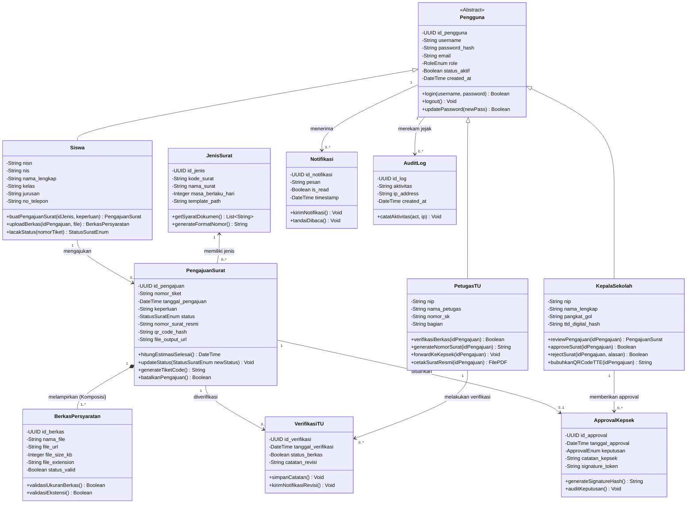
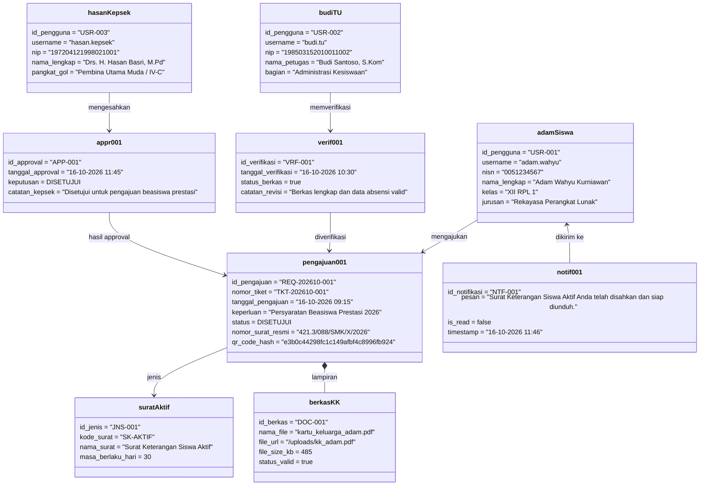

# TUGAS 6 - REKAYASA PERANGKAT LUNAK (RPL)
**PERANCANGAN CLASS DIAGRAM DAN OBJECT DIAGRAM BERDASARKAN SPESIFIKASI SISTEM**  
**PROGRAM STUDI TEKNIK INFORMATIKA - FTIK UNIVERSITAS INDRAPRASTA PGRI (UNINDRA)**  
**TAHUN AKADEMIK 2026/2027**

---

### IDENTITAS KELOMPOK (KELOMPOK RPL 7 / KELAS RPL_XD)
1. **Adam Wahyu Kurniawan** (NPM: 202343500510) - *Lead System Architect & Software Engineer*
2. **Fathu Rahman** (NPM: 202343500467) - *Business Analyst & Requirements Engineer*
3. **Surya Edi Saputra** (NPM: 202343500468) - *Quality Assurance & Technical Writer*
4. **Rizqi Muh. Al Hakimi** (NPM: 202343500449) - *Database Specialist & UI/UX*

* **Nama Proyek Perangkat Lunak:**  
  *Sistem Informasi Pengajuan Surat Siswa Berbasis Web (SIPESAT)*
* **Studi Kasus:**  
  Pelayanan Administrasi Persuratan Siswa & Tata Usaha Sekolah Menengah
* **Landasan Acuan Dokumen:**  
  * Dokumen Spesifikasi Kebutuhan Perangkat Lunak (SRS) Standar IEEE Std 830-1998 (Tugas 2)
  * Pemodelan Use Case Diagram & Matriks Hak Akses RBAC (Tugas 3)
  * Pemodelan Activity Diagram & Sequence Diagram Standar UML 2.5 (Tugas 4)
  * Pemodelan State Machine Diagram Siklus Hidup Surat (Tugas 5)

---

## BAB I: PENDAHULUAN & LANDASAN TEORI

### 1.1 Gambaran Umum Proyek SIPESAT
Sistem Informasi Pengajuan Surat Siswa Berbasis Web (SIPESAT) adalah platform layanan persuratan digital sekolah yang dirancang untuk mengotomatisasi proses birokrasi pengajuan surat keterangan siswa aktif, rekomendasi beasiswa, legalisir, dan dispensasi. Melalui arsitektur Role-Based Access Control (RBAC), sistem melibatkan tiga entitas pengguna utama yaitu Siswa, Staf Tata Usaha (TU), dan Kepala Sekolah. Setiap permohonan surat melewati alur hidup formal yang menuntut kepatuhan integritas data, validasi berkas fisik-digital, penomoran berurutan resmi sekolah, dan tanda tangan elektronik (TTE) berbasis kode QR terenkripsi.

### 1.2 Konsep Dasar Class Diagram (UML 2.5)
Class Diagram merupakan diagram pemodelan struktural statis utama dalam Unified Modeling Language (UML) 2.5. Diagram ini memodelkan struktur sistem perangkat lunak dengan mendefinisikan kelas-kelas, atribut, metode, serta hubungan keterkaitan antarkelas. 

Elemen-elemen formal yang menyusun Class Diagram:
1. **Kelas (Class)**: Cetak biru (blueprint) objek yang terdiri atas tiga kompartemen:
   * **Nama Kelas**: Identifier unik entitas.
   * **Kompartemen Atribut**: Karakteristik data dengan visibilitas (`+` public, `-` private, `#` protected), nama variabel, dan tipe data.
   * **Kompartemen Metode (Operasi)**: Fungsi atau perilaku fungsional yang dapat dieksekusi oleh kelas beserta tipe kembalian (*return type*).
2. **Relasi Antarkelas**:
   * **Generalisasi / Inheritance (`<|--`)**: Pewarisan atribut dan metode dari *Superclass* ke *Subclass*.
   * **Asosiasi (`-->` / `--`)**: Hubungan struktural antarkelas yang menunjukkan keterkaitan logis.
   * **Komposisi (`*--`)**: Hubungan kepemilikan mutlak di mana masa hidup kelas anak bergantung sepenuhnya pada kelas induk (*strong ownership*).
   * **Multiplisitas (`1..1`, `1..*`, `0..*`)**: Aturan kardinalitas jumlah instansiasi yang diizinkan berelasi.

### 1.3 Konsep Dasar Object Diagram (UML 2.5)
Object Diagram adalah diagram struktural yang merepresentasikan snapshot konkret dari Class Diagram pada satu titik waktu tertentu (*runtime snapshot*). Jika Class Diagram menggambarkan aturan abstrak, maka Object Diagram memodelkan data riil yang sedang menempati ruang memori saat sistem dijalankan.
Elemen pada Object Diagram ditandai dengan konvensi:
* Nama Objek: `namaObjek : NamaKelas` (dengan garis bawah).
* Nilai Atribut: Menyajikan pasangan nama atribut dan nilai konkretnya (misal: `status = DISETUJUI`).
* Link: Instansiasi konkret dari relasi asosiasi.

---

## BAB II: PERANCANGAN CLASS DIAGRAM SIPESAT

### 2.1 Visualisasi UML Class Diagram SIPESAT

---

### 2.2 Kamus Data Kelas (Class Dictionary)

| Nama Kelas | Kategori Layer | Atribut Utama | Metode Utama |
|---|---|---|---|
| **Pengguna** *(Abstract)* | Superclass RBAC | `id_pengguna: UUID`, `username: String`, `password_hash: String`, `email: String`, `role: RoleEnum`, `status_aktif: Boolean` | `+login()`, `+logout()`, `+updatePassword()` |
| **Siswa** | Subclass Pengguna | `nisn: String`, `nis: String`, `nama_lengkap: String`, `kelas: String`, `jurusan: String`, `no_telepon: String` | `+buatPengajuanSurat()`, `+uploadBerkas()`, `+lacakStatus()` |
| **PetugasTU** | Subclass Pengguna | `nip: String`, `nama_petugas: String`, `nomor_sk: String`, `bagian: String` | `+verifikasiBerkas()`, `+generateNomorSurat()`, `+forwardKeKepsek()`, `+cetakSuratResmi()` |
| **KepalaSekolah** | Subclass Pengguna | `nip: String`, `nama_lengkap: String`, `pangkat_gol: String`, `ttd_digital_hash: String` | `+reviewPengajuan()`, `+approveSurat()`, `+rejectSurat()`, `+bubuhkanQRCodeTTE()` |
| **JenisSurat** | Master Data | `id_jenis: UUID`, `kode_surat: String`, `nama_surat: String`, `masa_berlaku_hari: Integer`, `template_path: String` | `+getSyaratDokumen()`, `+generateFormatNomor()` |
| **PengajuanSurat** | Core Transaction | `id_pengajuan: UUID`, `nomor_tiket: String`, `tanggal_pengajuan: DateTime`, `keperluan: String`, `status: StatusSuratEnum`, `nomor_surat_resmi: String`, `qr_code_hash: String` | `+hitungEstimasiSelesai()`, `+updateStatus()`, `+generateTiketCode()`, `+batalkanPengajuan()` |
| **BerkasPersyaratan** | Entity Attachment | `id_berkas: UUID`, `nama_file: String`, `file_url: String`, `file_size_kb: Integer`, `status_valid: Boolean` | `+validasiUkuranBerkas()`, `+validasiEkstensi()` |
| **VerifikasiTU** | Transaction Log | `id_verifikasi: UUID`, `tanggal_verifikasi: DateTime`, `status_berkas: Boolean`, `catatan_revisi: String` | `+simpanCatatan()`, `+kirimNotifikasiRevisi()` |
| **ApprovalKepsek** | Transaction Log | `id_approval: UUID`, `tanggal_approval: DateTime`, `keputusan: ApprovalEnum`, `catatan_kepsek: String`, `signature_token: String` | `+generateSignatureHash()`, `+auditKeputusan()` |
| **Notifikasi** | Supporting Entity | `id_notifikasi: UUID`, `pesan: String`, `is_read: Boolean`, `timestamp: DateTime` | `+kirimNotifikasi()`, `+tandaiDibaca()` |
| **AuditLog** | Security & Telemetry | `id_log: UUID`, `aktivitas: String`, `ip_address: String`, `created_at: DateTime` | `+catatAktivitas()` |

---

## BAB III: PERANCANGAN OBJECT DIAGRAM SIPESAT

### 3.1 Narasi Skenario Instansiasi Konkret (Runtime Snapshot)
Pada hari Jumat, 16 Oktober 2026 pukul 09:15 WIB, seorang siswa kelas XII bernama **Adam Wahyu Kurniawan** (NISN: `0051234567`) membuat permohonan **Surat Keterangan Siswa Aktif** melalui portal SIPESAT dengan keperluan *"Persyaratan Beasiswa Prestasi 2026"*. Sistem menginstansiasi objek `pengajuan001 : PengajuanSurat` dengan kode tiket unik `TKT-202610-001` serta melampirkan berkas `berkasKK : BerkasPersyaratan`.

Pada pukul 10:30 WIB, Petugas Tata Usaha **Budi Santoso, S.Kom** memverifikasi kelayakan berkas fisik dan kehadiran siswa, mencatat verifikasi valid di `verif001 : VerifikasiTU`, dan menerbitkan draf nomor surat resmi. Pada pukul 11:45 WIB, Kepala Sekolah **Drs. H. Hasan Basri, M.Pd** meninjau draf tersebut dan memberikan pengesahan `appr001 : ApprovalKepsek` berstatus `DISETUJUI` dengan pembubuhan token tanda tangan digital SHA-256 (`qr_code_hash`). Notifikasi `notif001 : Notifikasi` otomatis terkirim ke akun siswa.

---

### 3.2 Visualisasi UML Object Diagram SIPESAT

---

## BAB IV: ANALISIS INTEGRASI ARSITEKTUR & IMPLEMENTASI

### 4.1 Pemetaan ke Skema Database Relasional (PostgreSQL / Prisma ORM)
1. **Pola Pewarisan**: Superclass abstrak `Pengguna` diimplementasikan dengan pola *Single Table Inheritance* (STI) pada tabel `tb_pengguna` dengan discriminator column `role` bertipe Enum (`SISWA`, `PETUGAS_TU`, `KEPALA_SEKOLAH`).
2. **Kardinalitas Integritas Data**: Relasi komposisi antara `PengajuanSurat` dan `BerkasPersyaratan` diterapkan secara fisik menggunakan constraint Foreign Key `ON DELETE CASCADE`, memastikan ketiadaan berkas yatim piatu di storage peladen.
3. **Kepatuhan ACID Transaksi**: Pembubuhan nomor surat resmi dan status approval Kepala Sekolah diikat dalam satu blok transaksi database atomik (`BEGIN TRANSACTION ... COMMIT`).

### 4.2 Keselarasan Hulu-Hilir dengan Diagram UML Terdahulu
* **Keselarasan dengan Use Case Diagram (Tugas 3)**: Method `buatPengajuanSurat()` dan `uploadBerkas()` memetakan secara persis Use Case *"Mengajukan Surat Permohonan"* dan *"Mengunggah Berkas Persyaratan"*.
* **Keselarasan dengan Sequence Diagram (Tugas 4)**: Urutan method invocation (`verifikasiBerkas()` ➔ `forwardKeKepsek()` ➔ `approveSurat()`) merefleksikan alur pertukaran pesan antar-lifeline boundary, control, dan entity.
* **Keselarasan dengan State Machine Diagram (Tugas 5)**: Atribut `status` pada kelas `PengajuanSurat` memuat nilai keadaan diskret (`DRAFT`, `MENUNGGU_VERIFIKASI`, `DIPROSES_TU`, `DISETUJUI`, `DITOLAK`) yang 100% konsisten dengan siklus hidup dokumen.

---

## BAB V: PENUTUP

### 5.1 Kesimpulan
1. **Class Diagram** berhasil memodelkan 11 kelas terstruktur dengan prinsip enkapsulasi data, pemisahan tanggung jawab (*Separation of Concerns*), serta hubungan pewarisan dan komposisi yang menjamin keutuhan data persuratan sekolah.
2. **Object Diagram** secara empiris membuktikan bahwa rancangan arsitektur beroperasi secara mulus pada skenario nyata penerbitan dokumen legal ber-QR Code tanpa adanya dead-lock atau konflik ketergantungan data.

### 5.2 Daftar Pustaka
1. Object Management Group (OMG). (2017). *Unified Modeling Language (OMG UML) Specification Version 2.5.1*.
2. Pressman, R. S., & Maxim, B. R. (2020). *Software Engineering: A Practitioner's Approach* (9th ed.). McGraw-Hill Education.
3. Sommerville, I. (2016). *Software Engineering* (10th ed.). Pearson Education.
4. Wiegers, K., & Beatty, J. (2013). *Software Requirements* (3rd ed.). Microsoft Press.
