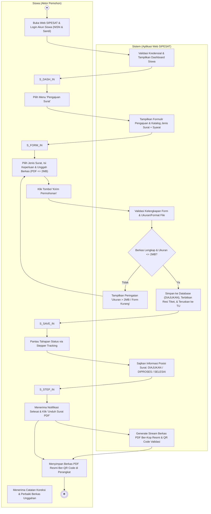
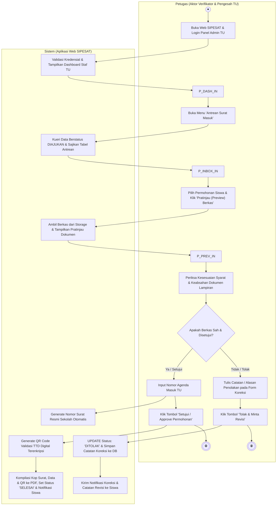

# 📋 DOKUMENTASI LENGKAP: USE CASE, ACTIVITY & SEQUENCE DIAGRAM (UNINDRA)
*Mata Kuliah Rekayasa Perangkat Lunak (RPL) UNINDRA — Kelompok 7 (Tahun 2026)*  
*Landasan Acuan: Slide Bahan Ajar Pertemuan 04 & Standar SRS Karl Wiegers*  
*Berkas Master Draw.io: [`use-case-siswa-admin.drawio`](file:///c:/A_main_code/all-my-projek/RPL/use-case-siswa-admin.drawio) (7 Halaman Tab XML Lengkap Sesuai Slide UNINDRA)*  
*Berkas Cetak PDF/HTML: [`use-case-siswa-admin.html`](file:///c:/A_main_code/all-my-projek/RPL/use-case-siswa-admin.html)*

---

## 🎯 1. Inti & Format Wajib Bahan Ajar UNINDRA (Pertemuan 04)

Berdasarkan modul resmi yang dikembangkan oleh Koordinator Bu Millati Izzatillah, S.Kom., MMSI dan tim pengembang bahan ajar RPL UNINDRA:

1. **Aturan Turunan Diagram (Slide 9 & 27)**:
   * **Activity Diagram** harus dibuat berdasarkan use case pada **Use Case Diagram**. Jumlah activity diagram minimal sama dengan use case utama sistem.
   * **Sequence Diagram** harus dibuat berdasarkan alur **Activity Diagram** yang sudah dimodelkan.
2. **Kaidah Activity Diagram (Slide 5–14)**:
   * Wajib menggunakan **Swimlane 2 Kolom**: Kolom kiri untuk **Aktor** dan kolom kanan untuk **Sistem**.
   * Simbol: Titik Mulai (*Start Node* lingkaran hitam padat), Aktivitas/State (persegi panjang tumpul dengan kata kerja), Percabangan/Decision (belah ketupat dengan cabang "Ya" dan "Tidak"), serta Titik Selesai (*End Node* bullseye).
   * **Wajib dilengkapi teks uraian langkah proses bernomor** (1, 2, 3, 4, 5...) di samping diagram.
3. **Kaidah Sequence Diagram (Slide 18–26)**:
   * Wajib menerapkan pola arsitektur **BCE (Boundary - Control - Entity)**:
     * `Boundary Class` (simbol `|O`): Komponen antarmuka pengguna / UI (misal: `LoginUI`, `PengajuanSuratUI`).
     * `Control Class` (simbol `↺O`): Komponen logika bisnis / controller (misal: `AuthController`, `SuratController`).
     * `Entity Class` (simbol `_O_`): Komponen tabel database / model data (misal: `User`, `SuratPengajuan`).
   * Menggunakan garis putus-putus (*lifeline*), kotak *activation bar* vertikal, dan pesan bernomor: `1. bukaAplikasi()`, `2. validasiData()`, dst.
   * Menggunakan kotak pembatas **`alt` (alternative frame)** dengan garis putus-putus untuk memisahkan skenario sukses (`[Valid]`) dan skenario gagal (`[Tidak Valid]`).

---

## 👥 2. Pemetaan Use Case Diagram (2 Role Eksklusif)

Sistem Informasi Pengajuan Surat Siswa (**SIPESAT**) hanya memiliki 2 peran:
* **Siswa (Aktor Pemohon)**:
  1. Registrasi Akun Mandiri (`UC-02`)
  2. Login ke Sistem (`UC-01` *<<include>>* `UC-01B` Validasi JWT)
  3. Kelola Profil & Sandi (`UC-03`)
  4. Lihat Katalog & Syarat Surat (`UC-05`)
  5. Mengajukan Permohonan Surat (`UC-06` *<<include>>* `UC-07` Unggah Berkas maks 2MB)
  6. Melacak Status Surat Real-time (`UC-08` *<<extend>>* `UC-08A` Catatan Revisi)
  7. Melihat Riwayat Pengajuan (`UC-09`)
  8. Unduh / Cetak Surat PDF & QR Code (`UC-10`)
  9. Logout Sesi (`UC-04`)
* **Admin (Aktor Pengelola & Verifikator)**:
  1. Login ke Sistem (`UC-01` *<<include>>* `UC-01B`)
  2. Kelola Profil Admin (`UC-03`)
  3. Akses Dashboard & Statistik Surat (`UC-11`)
  4. Memeriksa Antrean Masuk (`UC-12`)
  5. Verifikasi Berkas Dokumen (`UC-13`)
  6. Menyetujui (*Approve*) Permohonan (`UC-14` *<<include>>* `UC-14A` Terbitkan No. Surat & QR)
  7. Menolak (*Reject*) / Minta Revisi (`UC-15` *<<include>>* `UC-15A` Input Catatan Penolakan)
  8. Kelola Master Jenis Surat & Syarat (`UC-16`)
  9. Kelola Data Siswa & Akun Pengguna (`UC-17`)
  10. Ekspor Rekapitulasi Laporan Excel/PDF (`UC-18`)
  11. Logout Sesi (`UC-04`)

---

## 🔄 3. Rincian Activity Diagrams (Format Swimlane UNINDRA)

Berdasarkan kaidah modul bahan ajar UNINDRA (Slide 5-14), Activity Diagram dimodelkan dalam **Swimlane 2 Kolom (Aktor di kiri vs Sistem di kanan)** untuk masing-masing peran, serta dilengkapi **Activity Diagram Terpadu 3-Swimlane** untuk memvisualisasikan kolaborasi end-to-end.

---

### 3.1. Activity Diagram: Alur Pengajuan Surat oleh Siswa (Role Siswa)
* **Tab Master Draw.io**: Tab `2A. Activity Diagram (Role Siswa)`
* **Kaidah Swimlane 2 Kolom**: `Siswa (Aktor Pemohon)` vs `Sistem (Aplikasi Web SIPESAT)`
* **Simbol UML Sesuai Slide 5-7**: Start Node (● hitam padat), Activity (rounded rect diawali kata kerja), Decision (belah ketupat [Ya]/[Tidak]), Solid Transition line, End Node (⦿ bullseye).
* **Diagram Alur Mermaid**:

* **10 Uraian Langkah Kerja Role Siswa (Slide 5-7)**:
  1. **Inisiasi Login**: Siswa membuka website SIPESAT dan memasukkan NISN serta kata sandi terdaftar.
  2. **Validasi Kredensial**: Sistem memeriksa kredensial; jika valid, sistem menyajikan antarmuka Dashboard Siswa.
  3. **Akses Layanan**: Siswa memilih menu *'Pengajuan Surat'* pada bilah navigasi.
  4. **Penyajian Formulir**: Sistem memuat katalog master jenis surat (Aktif Sekolah, Rekomendasi, Izin, Mutasi) beserta daftar persyaratan dokumen.
  5. **Pengisian & Unggah**: Siswa memilih jenis surat, mengisi alasan keperluan, dan mengunggah berkas persyaratan (maksimal 2 MB).
  6. **Pengiriman**: Siswa menekan tombol *'Kirim Permohonan'*.
  7. **Validasi Berkas**: Sistem memeriksa kelengkapan form dan ukuran berkas:
     * Jika **Tidak Valid**: Sistem menampilkan peringatan dan meminta siswa mengoreksi unggahan.
     * Jika **Valid**: Sistem menyimpan data dengan status **DIAJUKAN**, menerbitkan resi tiket unik, dan meneruskan permohonan ke antrean Petugas TU.
  8. **Pemantauan Status**: Siswa memantau perjalanan surat via timeline stepper tracking real-time.
  9. **Pengunduhan PDF**: Setelah status berubah menjadi **SELESAI**, siswa menekan tombol *'Unduh Surat PDF'* dan sistem mengalirkan file digital resmi ber-QR Code ke perangkat siswa.
  10. **Selesai**: Rangkaian proses pengajuan surat oleh peran Siswa selesai tuntas.

---

### 3.2. Activity Diagram: Alur Verifikasi & Pengesahan Surat (Role Petugas TU)
* **Tab Master Draw.io**: Tab `2B. Activity Diagram (Role Petugas)`
* **Kaidah Swimlane 2 Kolom**: `Petugas (Aktor Verifikator TU)` vs `Sistem (Aplikasi Web SIPESAT)`
* **Simbol UML Sesuai Slide 5-7**: Start Node (●), Activity (rounded rect), Decision (belah ketupat), Solid Transition, End Node (⦿ bullseye).
* **Diagram Alur Mermaid**:

* **10 Uraian Langkah Kerja Role Petugas TU (Slide 5-7)**:
  1. **Autentikasi Petugas**: Petugas TU membuka aplikasi SIPESAT dan login ke panel staf TU.
  2. **Penyajian Dashboard**: Sistem memvalidasi hak akses Admin/TU dan menampilkan dasbor rekapitulasi surat.
  3. **Membuka Antrean**: Petugas mengakses menu *'Antrean Surat Masuk'* untuk melihat daftar pengajuan baru.
  4. **Kueri Data Sistem**: Sistem mengambil permohonan berstatus **DIAJUKAN** dan menyajikannya secara terurut tanggal pengajuan.
  5. **Pratinjau Berkas**: Petugas memilih permohonan siswa; sistem menampilkan pratinjau dokumen lampiran yang diunggah siswa.
  6. **Pemeriksaan Dokumen**: Petugas menelaah kelengkapan data, format berkas, dan keaslian syarat administratif.
  7. **Keputusan Evaluasi**:
     * **Skenario Tolak / Minta Revisi**: Petugas mengisi catatan alasan penolakan dan menekan *'Tolak & Minta Revisi'*. Sistem mengubah status menjadi **DITOLAK** dan mengirimkan notifikasi koreksi ke akun siswa.
     * **Skenario Setujui / Approve**: Petugas mengisi nomor agenda surat masuk TU dan menekan *'Setujui / Approve'*.
  8. **Penomoran Otomatis**: Sistem secara otomatis men-generate nomor surat resmi sekolah sesuai format baku (*421.3/XXX/SMK-PSKD3/X/2026*).
  9. **Penerbitan Digital & QR Code**: Sistem men-generate QR Code validasi tanda tangan digital, menggabungkannya ke berkas PDF resmi ber-kop sekolah, memperbarui status menjadi **SELESAI**, serta mengirimkan notifikasi siap unduh ke siswa.
  10. **Selesai**: Rangkaian proses verifikasi dan pengesahan surat oleh Petugas TU selesai tuntas.

---

### 3.3. Activity Diagram Terpadu: Alur Pengajuan Surat (Dari Siswa Sampai Petugas)
* **Tab Master Draw.io**: Tab `2C. Activity Diagram Terpadu (Siswa s.d Petugas)`
* **Swimlane Terintegrasi 3 Kolom**: `Siswa (Aktor Pemohon)` | `Sistem (SIPESAT Web)` | `Petugas (Aktor Verifikator TU)`
* **Fungsi**: Memvisualisasikan kolaborasi end-to-end penyerahan berkas dari pemohon (Siswa), orkestrasi perantara sistem, hingga pengesahan dan penerbitan dokumen oleh verifikator (Petugas TU).

### 3.1. Activity Diagram 1: Login ke Sistem
* **Swimlane**: `Pengguna (Siswa/Admin)` vs `Sistem`
* **Uraian Alur**:
  1. Pengguna membuka aplikasi SIPESAT.
  2. Pengguna memasukkan NISN/Email dan kata sandi.
  3. Pengguna mengklik tombol Login.
  4. Sistem melakukan validasi data akun:
     * Jika **'Ya' (valid)**, sistem menampilkan Dashboard sesuai peran.
     * Jika **'Tidak' (gagal)**, sistem menampilkan pesan kesalahan login.
  5. Selesai.

### 3.2. Activity Diagram 2: Pengajuan Surat oleh Siswa
* **Swimlane**: `Siswa` vs `Sistem`
* **Uraian Alur**:
  1. Siswa memilih menu Pengajuan Surat.
  2. Sistem menampilkan formulir pengajuan dan katalog jenis surat.
  3. Siswa memilih jenis surat, mengisi keperluan, dan mengunggah berkas syarat (maks 2MB).
  4. Siswa mengklik tombol Simpan Pengajuan.
  5. Sistem memvalidasi kelengkapan form dan file:
     * Jika **'Ya' (lengkap)**, sistem menyimpan ke DB, memberi status DIAJUKAN, dan menampilkan resi tiket.
     * Jika **'Tidak'**, sistem menampilkan pesan peringatan koreksi input.
  6. Selesai.

### 3.3. Activity Diagram 3: Verifikasi & Approval oleh Admin
* **Swimlane**: `Admin` vs `Sistem`
* **Uraian Alur**:
  1. Admin memilih antrean surat masuk pada tabel.
  2. Sistem menampilkan detail permohonan dan pratinjau berkas lampiran.
  3. Admin memeriksa kelayakan berkas dan memilih aksi keputusan:
     * **Jika Disetujui ('Ya')**: Admin mengklik Approve. Sistem men-generate nomor surat resmi dan kode QR, lalu mengubah status menjadi SELESAI.
     * **Jika Ditolak ('Tidak')**: Admin memasukkan catatan revisi dan mengklik Tolak. Sistem menyimpan alasan penolakan dan mengubah status menjadi DITOLAK.
  4. Sistem menyimpan hasil keputusan ke database.
  5. Selesai.

### 3.4. Activity Diagram 4: Tracking & Cari Status Surat
* **Swimlane**: `Siswa` vs `Sistem`
* **Uraian Alur**:
  1. Siswa membuka menu tracking atau riwayat pengajuan surat.
  2. Siswa memasukkan kata kunci (nomor tiket/nama surat) atau memilih filter status.
  3. Siswa mengklik tombol Cari atau Terapkan Filter.
  4. Sistem memproses pencarian query ke database:
     * Jika ditemukan (**'Ya'**), sistem menampilkan daftar surat lengkap beserta stepper status pelacakan.
     * Jika tidak ditemukan (**'Tidak'**), sistem menampilkan notifikasi *'data tidak ditemukan'*.
  5. Selesai.

---

## ⚡ 4. Rincian 4 Sequence Diagrams (Pola BCE UNINDRA)

| No | Nama Diagram | Boundary (UI) | Control (Controller) | Entity (Model/DB) | Percabangan Alt |
| :---: | :--- | :--- | :--- | :--- | :--- |
| **1** | **Sequence Login** | `LoginUI` | `AuthController` | `User` | `[Login Valid]` vs `[Login Tidak Valid]` |
| **2** | **Sequence Pengajuan Surat** | `PengajuanSuratUI` | `SuratController` | `SuratPengajuan` | `[Data Lengkap & File <= 2MB]` vs `[Data Tidak Lengkap]` |
| **3** | **Sequence Approval Surat** | `VerifikasiSuratUI` | `VerifikasiController` | `SuratPengajuan` | `[Persetujuan / Approve]` vs `[Penolakan / Reject]` |
| **4** | **Sequence Cari & Filter** | `DashboardUI` | `SuratController` | `SuratPengajuan` | `[Hasil Ditemukan]` vs `[Hasil Tidak Ditemukan]` |

---

## 📋 5. Matriks Hak Akses Peran (RBAC Matrix)

| No | Modul & Kasus Penggunaan | Hak Akses Siswa | Hak Akses Admin | Aturan Bisnis (*Business Rules*) |
| :---: | :--- | :---: | :---: | :--- |
| 1 | **Registrasi & Login Akun** | `CREATE`, `READ` | `READ` (Login) | Siswa registrasi mandiri via NISN; Akun Admin terdaftar khusus di sistem. |
| 2 | **Katalog Master Jenis Surat** | `READ` | `C, R, U, D` | Siswa hanya memilih surat aktif; Admin mengonfigurasi master jenis surat & syarat. |
| 3 | **Pengajuan Surat & Berkas** | `CREATE`, `UPLOAD` | `READ`, `DOWNLOAD` | Siswa mengisi formulir & melampirkan berkas (PDF/JPG/PNG maks 2MB). |
| 4 | **Verifikasi Kelayakan Berkas** | *Tidak Ada Akses* | `READ`, `UPDATE` | Admin memeriksa keabsahan syarat & mengubah status DIAJUKAN menjadi DIPROSES. |
| 5 | **Approval & Penomoran Resmi** | *Tidak Ada Akses* | `UPDATE`, `GENERATE` | Approval otomatis menerbitkan nomor unik surat resmi dan QR Code digital. |
| 6 | **Penolakan & Catatan Revisi** | `READ` (Lihat Catatan) | `UPDATE`, `CREATE` | Admin wajib mengisi alasan penolakan agar siswa dapat merevisi berkasnya. |
| 7 | **Tracking Status & Stepper** | `READ` (Data Pribadi) | `READ` (Seluruh Siswa) | Timeline dinamis: DIAJUKAN ➔ DIPROSES ➔ SELESAI / DITOLAK. |
| 8 | **Unduh Surat Digital (PDF)** | `READ`, `DOWNLOAD` | `READ`, `DOWNLOAD` | File PDF ber-QR Code hanya bisa diunduh setelah status mencapai SELESAI. |
| 9 | **Manajemen Data Siswa** | *Tidak Ada Akses* | `C, R, U, D` | Admin mengelola data master siswa, aktivasi status, dan penanganan reset akun. |
| 10 | **Dashboard & Laporan** | *Tidak Ada Akses* | `READ`, `EXPORT` | Admin memantau statistik dan ekspor rekapitulasi ke Excel/PDF. |
